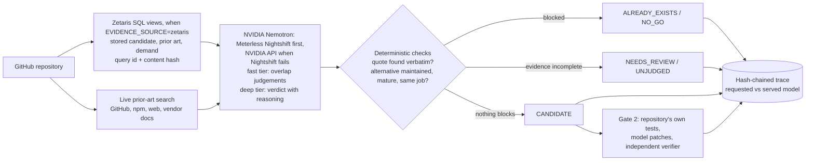

# PhoenixRepo

**Before anyone spends a weekend reviving an abandoned GitHub repository, PhoenixRepo checks whether the idea already exists in a maintained form, and explains every refusal with evidence a reviewer can check line by line.**

Open Agent Hackathon 2026, Track 02 "The Agent That Can Explain Why". Solo entry.

## Try it in 30 seconds, no tokens

```bash
pip install -r requirements.txt
python main.py
# open http://127.0.0.1:8000/ui
```

No install at all: **https://fu93.github.io/phoenixrepo/** is the same page as a static copy, rebuilt from `main` by `.github/workflows/pages.yml` (`scripts/export_static_ui.py`; the chain and tamper results there were computed by `scripts/verify_trace.py` at export time). Or `docker build -t phoenixrepo . && docker run --rm -p 8000:8000 phoenixrepo`. The page replays recorded gate-1 runs step by step: which model answered each call, the alternative that blocked the idea, the quote that was checked word for word, and the hash chain. **Tamper** changes one character of a copy in memory and the chain check fails. Replays labelled SAMPLE are reconstructions; RECORDED ones are real trace files copied byte for byte.

## How it decides



Three rules carry the design:

1. **The model proposes, the code verifies.** A refusal needs a quote that appears verbatim in the alternative's own text and an alternative that passes the maturity checks. Nemotron's reasoning is shown next to the verdict as its account; it never decides on its own.
2. **A failure is never "no competition".** A search error, a Nightshift 502, an expired token or a stopped Zetaris gives `NEEDS_REVIEW` or `UNJUDGED`, never `CANDIDATE`. Gate 2 cannot run without a `CANDIDATE`.
3. **Every claim can be checked.** Each step is a line in a hash-chained trace with the model requested and the model that actually answered; `scripts/verify_trace.py` fails if one character changes, and with `--require-nemotron` also fails unless every answer used was Nemotron's.

## The decision, read as VRIO

The two gates follow the VRIO test from strategic management (Barney), applied to an abandoned project's idea instead of a firm's resource. Each question is answered by a check in the code, not by the model's opinion, and each answer leads to a verdict:

| VRIO question | What PhoenixRepo checks | If the answer is no |
| --- | --- | --- |
| **Valuable**: does it do a real job for someone? | The problem, stated with a quote found verbatim in the repository's own text, and external demand signals. The repository's own stars are never used as demand. | `NO_GO` |
| **Rare**: is that job not already done well? | Prior-art search on GitHub, npm and the web. An alternative that does the same job for the same user (the Jobs-to-be-Done test), is maintained, mature or official, and is backed by a verbatim quote makes the idea not rare. | `ALREADY_EXISTS` |
| **Inimitable**: what gap would a revival own? | Alternatives that overlap only partly, or are too small to block, are kept as "must beat", with the reason each did not block (another setting, a paid-only feature, no self-hosting). That gap is the revival's position, and the rescue plan's UPGRADE stage is written against it. | `CANDIDATE`, with the gap to beat stated |
| **Organized**: can it actually be brought back? | Gate 2: a rescue plan (REVIVE, OPTIMISE, UPGRADE) for every CANDIDATE, each item tied to recorded evidence; then, where a test command exists, patches that count only when the repository's own tests pass and no test was weakened. | plan says "add a test command first", or `RESURRECTION_FAILED` / `NEEDS_REVIEW` |

Evidence that is missing or failed (a search error, a model outage, a search cut short) answers no question, so it gives `NEEDS_REVIEW`, the Stage-Gate "hold". Open-source code is cheap to copy, so "inimitable" here means the user, setting or access the alternatives leave open, not secrecy; the gate does not claim a lasting advantage.

## Sponsor technology

| Sponsor | What it does here | Where |
| --- | --- | --- |
| **Zetaris** | Gate 1 loads the stored candidate, prior-art and demand rows from the `phoenix.*` views over the REST SQL contract. Each statement is a trace line with its SQL, `query_id` and `content_hash`; a read-only preflight stops the run if Zetaris is down instead of guessing. | `app/adapters/zetaris_evidence.py`, `scripts/zetaris_check.py` |
| **Meterless Nightshift** | Tried first for every gate-1 model call, and the route gate 2 requests by design (gate 2 has not run on a real `CANDIDATE` in this submission). Every call records `requested_model`, `served_model`, latency and any routing detail Nightshift returns. | `app/agents/relevance.py`, `scripts/nightshift_probe.py` |
| **NVIDIA Nemotron** | Two requested tiers on gate 1: `MODEL_NAME` plus `PHOENIX_LLM_EXTRA_BODY` for bulk overlap checks, `MODEL_NAME_DEEP` plus `PHOENIX_LLM_DEEP_EXTRA_BODY` for the final verdict. `PHOENIX_NEMOTRON_POLICY` is `label`, `require`, or `fallback-nvidia`. With `fallback-nvidia`, a Nightshift timeout, HTTP 5xx, or non-Nemotron answer is sent again to NVIDIA's API and traced as provider `nvidia-direct`. `/ui` shows the "N of M answers by NVIDIA Nemotron" badge and a Nemotron reasoning card. Measured share: [Why Nemotron](#why-nemotron). | `app/agents/relevance.py`, `scripts/eval_gate1.py` |
| **Meterless H-MEM, Markovian** | Memory of evidence claims and verdicts, and the bounded multi-step loop, in the evidence-policy track (`POST /run`). | `app/engines/` |

## Where to look, by judging criterion

| Criterion | Look at |
| --- | --- |
| Impact | The problem above; refusal reports in `/ui`; `data/eval/gate1_labels.json` (human labels with the quotes that justify them) |
| Technical | The trace and its verifier; `app/revive_verify.py` (tamper-resistant gate 2); `tests/` run in CI on every PR |
| Innovation | Judging the idea before the code; verbatim-quote verification of model claims; Nemotron-only policy that one command verifies (`verify_trace.py --require-nemotron`) |
| Demo | `GET /ui` replays, served-model table, tamper check |
| Product & UX | One command per job: `scripts/judge_repo.py <url>` writes an HTML report; `/ui` needs no setup |
| Sponsor | The table above |

The honest limits are in [Limits](#limits). This README then documents the current behaviour in detail. The later sections cover the earlier Zetaris evidence-policy track (`POST /run`), which is still in the repository and still tested. `PRE_EVENT_PLAN.md` and `OPENING_READY.md` are the 8 October 2026 skeleton notes; where they disagree with this file, this file is the current behaviour.

## Results

The scored numbers are one live gate-1 run of the 16 audited cases in `data/eval/gate1_labels.json`, all judged by the same commit. `scripts/fill_results.py` writes every number in this section and the next from that run's report and its trace files, so no cell is retyped. An earlier 30-repository batch, dated 25 Oct 2026, stays under [Current status of the two gates](#current-status-of-the-two-gates-25-oct-2026); it is a different run.

```bash
python scripts/eval_summary.py logs/eval-nemotron-v3.json --markdown
python scripts/fill_results.py logs/eval-nemotron-v3.json --write
```

A live run on one machine, not a stored accuracy. "False pass" means a case the human label says to refuse was not refused. The line under the per-case table says how many of those came back `CANDIDATE`, which would let gate 2 plan a revival of an idea that already exists.

<!-- BEGIN numbers: eval-summary-table -->
**TBD.**
<!-- END numbers: eval-summary-table -->

<!-- BEGIN numbers: per-case-table -->
**TBD.**
<!-- END numbers: per-case-table -->

### Zetaris scope

Gate 1 can read its evidence from Zetaris (`EVIDENCE_SOURCE=zetaris`). In this submission Zetaris was exercised live, read-only, on the 2 repositories in `data/real`: `tharani-2006/Invoice-generator-application` and `SergioMendolia/ytkb`. `scripts/zetaris_check.py` loads their evidence rows and seals a trace; it calls no model and writes no verdict.

<!-- BEGIN numbers: zetaris-gate1-run -->
Gate 1 was then run with its evidence read from Zetaris (`EVIDENCE_SOURCE=zetaris`, `python scripts/score_candidates.py --snapshot data/real --llm`) on those 2 repositories, on 26 Oct 2026. Run hash `4f340332cd1349884bb5355d471f03e89d5b778cf378ccb20ccda4b74472ebad`, trace `logs/trace-zetaris-gate1.jsonl` on the author's machine. `scripts/verify_trace.py --require-nemotron` passed: 27 of 27 answers used were Nemotron's (Nightshift 21, `nvidia-direct` 6; served `nvidia/nemotron-3-ultra-550b-a55b` 24, `nvidia/nemotron-3.5-super-vl-120b-a12b` 3, the latter chosen by Nightshift).

| Repository | Verdict with Zetaris evidence | Human label |
| --- | --- | --- |
| `tharani-2006/Invoice-generator-application` | `ALREADY_EXISTS` (maintained free alternatives such as Invoify) | `ALREADY_EXISTS` |
| `SergioMendolia/ytkb` | `CANDIDATE`, flagged `LLM_FALLBACK` | `ALREADY_EXISTS` |

ytkb is a false pass on this run. An earlier trial returned `NEEDS_REVIEW` on a partial overlap with JetBrains/youtrack-cli, and the human label names kd-cli. Zetaris supplied the evidence rows with their query ids and content hashes; it does not make a verdict more accurate. This run is not part of the scored table above.
<!-- END numbers: zetaris-gate1-run -->

The 16 evaluation repositories are the audit cases in `data/eval/gate1_labels.json`, the set `scripts/eval_gate1.py --audit-only` judges. Those 16 were fetched live from the GitHub API by `scripts/judge_repo.py`, and each verdict records `evidence_source=csv`. A single repository fetched live is not a row in the curated `phoenix.*` views, so that command does not ask Zetaris for it. This submission does not claim that all 16 went through Zetaris.

`scripts/zetaris_check.py` sends only the read-only `SELECT` statements in `app/sql_catalog.py`: a preflight, then `phoenix.discovery_candidates`, `phoenix.prior_art`, and `phoenix.demand_signals`. It prints each `query_id` and `content_hash`, then seals a trace. The seal's `line_hash` is the run hash printed at the end of the command. `scripts/verify_trace.py` recomputes that chain. `--expected-run-hash` fails when the sealed hash differs from the hash you recorded.

### Before and after: the same 16 audited repositories

| Run | Answers by | Verdicts inside the human label | Over-refusals | False passes |
| --- | --- | --- | --- | --- |
| 25 Oct 2026 batch | `gemini-3.1-flash-lite` and `gemini-3.5-flash-lite` (served for Nemotron requests; recorded only at problem extraction) | 5 of 16 | 11 of 11 | 0 of 5 |
| Scored run, 26 Oct 2026 | Nemotron, every answer used | 10 of 16 | 1 of 11 | 4 of 5 |

All 16 were `ALREADY_EXISTS` in the 25 Oct batch, which is why the human audit exists: 11 of those refusals were weak or wrong. The code changed between the two runs as well as the model (the maturity rule, quote checks, coverage guards), so this is the pipeline and the model together, not the model alone. The trade-off is visible: over-refusals fell from 11 to 1, and false passes rose from 0 to 4. The causes of those four are in [Limits](#limits): a GitHub repository found by web search is not looked up as a repository, and a quoted full overlap below the maturity bar only warns.

### Before and after: CalendarSyncProject

`DSRegoitia/CalendarSyncProject` was rejected by the older Phoenix because FullCalendar "displays public Google Calendar events". The human label in `data/eval/gate1_labels.json` calls that a WRONG over-rejection: the candidate pushes events the other way, from FullCalendar into Google Calendar. `ALREADY_EXISTS` is outside the acceptable set. The acceptable set is `CANDIDATE` or `NEEDS_REVIEW`.

The current gate 1 returns `CANDIDATE` or `NEEDS_REVIEW` for this repository. Both sit inside that acceptable set. `NEEDS_REVIEW` on this case is a partial overlap: a verbatim quote is handed to a human. Two independent runs, with different generated queries, returned `CANDIDATE` and `NEEDS_REVIEW`.

The run recorded for the submission is still open.

<!-- BEGIN numbers: calendarsync-final-verdict -->
Final verdict on the recorded run: **TBD** (`CANDIDATE` or `NEEDS_REVIEW`).
<!-- END numbers: calendarsync-final-verdict -->

<!-- BEGIN numbers: calendarsync-final-run-hash -->
Final run hash (`RUN_SEAL` `line_hash`, the value `scripts/verify_trace.py --expected-run-hash` checks): **TBD**.
<!-- END numbers: calendarsync-final-run-hash -->

### What a passing verdict is allowed to mean

A blocker needs a verified verbatim quote plus a mature or official alternative. Infrastructure failures are recorded as `NEEDS_REVIEW` or `UNJUDGED`, never a silent pass. A prior-art search cut short by the tool budget marks each unfinished source `BUDGET_EXHAUSTED`. `judge_discovery` then records `NEEDS_REVIEW` with the reason "tool budget exhausted" where the model had said `CANDIDATE`. `BUDGET_EXHAUSTED` can never produce `CANDIDATE`. A verified full overlap that already passes the maturity checks can still be `ALREADY_EXISTS`. An alternatives phase that stops with chunks unjudged follows the same rule in `judge_partial_alternatives`: unjudged chunks never produce `CANDIDATE`.

## Why Nemotron

Target prize: Best use of NVIDIA Nemotron.

**Eligibility at a glance (rule 15.2).**

| Requirement | Where it is met |
| --- | --- |
| At least one Nemotron model, through Meterless Nightshift | Every gate-1 call requests `nvidia/nemotron-*` from Nightshift first; the provider split below counts the Nightshift answers. The Zetaris-backed run: 21 of its 27 answers came through Nightshift. |
| In a working feature | The gate-1 judge: problem extraction, every overlap check, and the verdict. Gate 2's rescue plan, run with Nemotron on 3 CANDIDATEs (see its live status). |
| Shows which model handled the request | `served_model` on every `LLM_CALL` trace line, the served-model table and badge in `/ui`, the evidence report, and `python scripts/verify_trace.py <trace> --require-nemotron`. |

Nemotron is used through Meterless Nightshift, in the working gate-1 judge, and the model that handled each request is shown on every trace line, in `/ui` and in the evidence report. NVIDIA's own API is a fallback for calls Nightshift fails; the provider split below counts both. The same facts are in `metadata.json`.

Track 02 asks for an agent that can explain why. Gate 1 keeps any reasoning Nemotron returns in the trace next to the verbatim quote the verdict rests on, and Nemotron 3 is an open model family, so the judgement can be checked and rerun outside any one vendor's service.

Gate 1 asks NVIDIA Nemotron in two requested tiers. Nightshift is tried first. The served id on each trace line is the id that actually answered.

Two facts about the served size on the scored run. Nightshift chooses which Nemotron size answers, so the requested tier is not always the size served: on the scored run Nightshift answered most requests of both tiers with `nvidia/nemotron-3-ultra-550b-a55b` (the tier table below has the counts). The two tiers differ in what is requested and in the thinking setting, not reliably in the size that answered. NVIDIA's API answered HTTP 404 for `nvidia/nemotron-3-super-120b-a12b` on this account, so `NVIDIA_MODEL` is `nvidia/nemotron-3-ultra-550b-a55b` and is the id requested by every `nvidia-direct` call, on both tiers. Which model actually answered, per provider, is counted from the traces in the provider-split line below; the served id on each line is the record.

- Bulk alternative-overlap checks (`problem`, `alternative`, `coverage`, `demand`) use `MODEL_NAME`. `PHOENIX_LLM_EXTRA_BODY` is the JSON object merged into that request; `{"chat_template_kwargs": {"enable_thinking": false}}` turns Nemotron's thinking off there. It was set on the scored run, so fast-tier requests asked for thinking off; whether each provider honoured the setting was not checked.
- The final verdict uses `MODEL_NAME_DEEP` (equivalently `PHOENIX_DEEP_MODEL`). The default deep step is `discovery`, set by `PHOENIX_DEEP_STEPS`. Its body is `PHOENIX_LLM_DEEP_EXTRA_BODY`; on the scored run it was empty, so thinking was left at the model's default rather than switched on explicitly. When the reply carries a `reasoning_content` field or a `<think>` block, it is stored, head and tail, on that deep-tier `LLM_CALL` line; how many final-verdict answers carried one is counted in the Nemotron evidence below.

`PHOENIX_NEMOTRON_POLICY` has three labels.

| Policy | What happens when Nightshift does not answer with `nvidia/nemotron-*` |
| --- | --- |
| `label` (default) | The answer is used and the line is flagged `MODEL_MISMATCH`. |
| `require` | The answer is discarded, the line is flagged `DISCARDED_BY_POLICY`, and Nightshift is asked again. |
| `fallback-nvidia` | Nightshift is tried first. On a timeout, an HTTP 5xx, or a non-Nemotron answer, the same request goes to NVIDIA's official API (`https://integrate.api.nvidia.com/v1`, key `NVIDIA_API_KEY`). The trace records provider `nvidia-direct`. A direct reply that is still outside `nvidia/nemotron-*` is rejected and does not inform the verdict. |

`served_model` is stored as the provider returned it. The requested id is not copied over it. The field is inside the hashed body of the `LLM_CALL` line, so a later edit fails `scripts/verify_trace.py`. That script recomputes `prev_hash` and `line_hash`, requires the last line to be `RUN_SEAL`, and with `--expected-run-hash` checks the run hash. With `--require-nemotron` it also fails unless every answer the run used was served by `nvidia/nemotron-*`, and prints that count and the provider split (Nightshift or `nvidia-direct`). `served_model` and the provider are inside each line's hash, so a line edited to read Nemotron fails the chain before the family check runs:

```bash
python scripts/verify_trace.py logs/trace-<run_id>.jsonl --require-nemotron
```

 The `/ui` badge and `scripts/eval_summary.py` count used answers whose `served_model` starts with `nvidia/nemotron-*` (`config.settings.is_nemotron_family`). A discarded or rejected line is not an answer used.

`/ui` shows an "N of M answers by NVIDIA Nemotron" badge, built from `answers_by_nemotron` and `answers_used`. The verdict card includes a Nemotron reasoning card: the heading is "Nemotron's reasoning" when the used final-verdict answer is in the Nemotron family, and the page says that text is the model's account. The verdict still stands only when its quotes are found verbatim and the alternative passes the maturity checks.

<!-- BEGIN numbers: nemotron-answer-share -->
Answers by NVIDIA Nemotron on the scored run: **TBD** of **TBD**. The same share is the Nemotron row of the table in [Results](#results).
<!-- END numbers: nemotron-answer-share -->

<!-- BEGIN numbers: provider-split -->
Provider split on that run, Nightshift answers used / `nvidia-direct` answers used, as printed by `verify_trace.py --require-nemotron`: **TBD** / **TBD**.
<!-- END numbers: provider-split -->

How Nemotron was used on the scored run, counted from the same verified traces: which tier answered with which served model, how long live answers took, and how often Nightshift failed and NVIDIA's API answered instead.

<!-- BEGIN numbers: nemotron-evidence -->
**TBD**
<!-- END numbers: nemotron-evidence -->

**Sampling.** Requests are sent with `temperature: 0`, so a verdict is reproducible and an answer can be cached and replayed. NVIDIA's guidance for Nemotron's reasoning mode is `temperature` 0.6 and `top_p` 0.95; `PHOENIX_LLM_DEEP_EXTRA_BODY='{"temperature": 0.6, "top_p": 0.95}'` applies it to the verdict tier only. The trade-off is deliberate: a verdict must be repeatable, and its claims are checked by code either way. The setting a run used is in that run's `.env`.

**Running the judge on your own Nemotron.** Both model routes are OpenAI-compatible base URLs. Pointing `METERLESS_BASE_URL` (or, for the fallback, `NVIDIA_BASE_URL`) at a local server that serves Nemotron, for example an NVIDIA NIM container on a DGX Spark, runs the same judge with the same trace and the same `--require-nemotron` check; `served_model` records whatever the local server reports. Nemotron 3 is an open model family, so a verdict can then be rerun with no external service. This path is configuration only and was not tested in this submission.

The same page, with no install, is the static demo at <https://fu93.github.io/phoenixrepo/>. Replays shipped in this repository stay labelled SAMPLE until `scripts/import_replay.py` copies a real trace byte for byte and labels it RECORDED.

## What it does now: two gates

PhoenixRepo takes a GitHub repository and answers two questions in order. It refuses early, says why, and writes every step to a hash-chained trace so a human can check the refusal.

1. **Gate 1: is the idea worth rescuing?** Judging code health comes second. A well-built clone of a product that already exists is not worth a revival.
2. **Gate 2: can it be brought back to a green test run?** This runs only when gate 1 said `CANDIDATE`.

### Gate 1: is the idea worth rescuing

Entry points: `python scripts/judge_repo.py <github-url>` (one repository, writes `reports/<run_id>/report.html`) and `python scripts/run_sharded.py --snapshot <dir> --run-id <id> --shards N` (a batch over a discovery snapshot, parallel shards, resumable because finished LLM answers and tool results are cached on disk; the merged ranking is `logs/<run_id>_scores.md`; no protagonist is chosen automatically, a human picks it from the ranking). Both run `scripts/score_candidates.py`, so a single judgement and a batch use the same pipeline.

What it does:

1. **Understand the repository.** It reads the description, README and file tree and extracts the problem the repository tries to solve and its target user. Every quote the model gives must appear verbatim in the repository text, or the verdict becomes `NEEDS_REVIEW`.
2. **Search for prior art** in GitHub, npm and PyPI, and on the web. Web search tries Exa (its keyless public MCP endpoint, used only as a search source and never as an AI provider), then Parallel, then Keenable (also keyless MCP), then DuckDuckGo HTML, and adds Hacker News stories as a supplement. Queries include "best X tools", "X alternatives" and official-feature queries ("<platform> built-in <job>"). Mainstream products and an official built-in feature of a platform count as prior art. Web results get the largest share of the result quota so they are not crowded out by GitHub rows.
3. **Judge each alternative** (same problem or not, full / partial / no overlap, verbatim quote checked against that alternative's own text). Alternatives are judged in chunks of 2. A reply that is cut off keeps every JSON object that already closed, and only the missing indexes are retried. A chunk that returns nothing parseable, or whose calls fail, falls back to one call per alternative in that chunk. Every call is a trace line with `requested_model` and `served_model`. The per-repository alternatives budget is `max(600 seconds, 90 seconds × chunks)`, then capped at 3600 seconds. Only a failed call spends that clock; a judgement does not. One attempt is still bounded by the client's total timeout (420 seconds), which is long enough for a healthy call of a few minutes. `PHOENIX_ALTERNATIVES_BUDGET_S` sets the budget directly (still under the cap). `PHOENIX_ALTERNATIVES_BUDGET_FLOOR_S`, `PHOENIX_ALTERNATIVES_CHUNK_SECONDS`, and `PHOENIX_ALTERNATIVES_BUDGET_CAP_S` change the formula. A finished call is written to the relevance cache under a key that includes the requested model, so a rerun with the same inputs reuses a judged batch chunk and calls the model again only for a chunk that did not finish. The partial trace records `verified_chunk_indexes`.
4. **Decide.** Stars and forks feed the maturity rule and the rescue-potential score. A search that errors is a source error: the verdict is `NEEDS_REVIEW` with `INSUFFICIENT_PRIOR_ART_COVERAGE`. A verified full overlap refuses the repository only when the alternative also passes every maturity check: (A) the same job, user and platform (a syscall, a standard, an article or listicle, a category or aggregator page, or a docs page for a different usage mode is not an alternative); (B) not archived, and pushed or released within 12 months, except a first-party vendor docs or feature page, which needs no push date; (C) at least 100 stars and at least half the candidate's stars, or an official or commercial product with a dated release or a pricing page, or a first-party vendor docs or feature page. That page counts as official regardless of stars or push dates when its domain is the vendor's own domain of the product the page describes (for example `pagerduty.com/docs`, `docs.datadoghq.com`, `support.atlassian.com`), the quote is verified, and the job and user match. A blog, a docs platform such as Read the Docs, and a code host do not. A page whose text names a different product does not; (D) a free tier or a permissive licence when the candidate is free and self-hostable. A vendor feature is a mismatch on access only when the quote shows it is paid-only and the candidate's core value is being free; that reason is recorded. A quote that does not say paid-only is not treated as a mismatch; (E) for a GitHub, Codeberg or GitLab alternative, those fields come from that host's API, and an alternative whose fields cannot be fetched cannot block (`source_error`, recorded, and it does not count as overlap). GitHub facts are a cached REST call. `GITHUB_TOKEN` is read from the environment when it is set and is never written to the cache or to a log. An alternative that fails B–E stays in the report as context the candidate must beat, and the verdict continues toward `CANDIDATE` or `NEEDS_REVIEW`. The quote check is unchanged: a quote that is not in the alternative's own text becomes `NEEDS_REVIEW`. A partial overlap of a maintained, mature product still goes to `NEEDS_REVIEW`. The HTML report and the batch markdown list, for every `ALREADY_EXISTS` and `NEEDS_REVIEW`, the alternative name, the overlap level, the verified quote, and the reason. They also list alternatives that did not block. Every gate-1 row stores a rescue-potential score computed from repository facts with no model call: stars, forks, open issues from non-owners with 0–1 comments and a failure-style title, days since the last push, stars versus staleness, the last default-branch CI conclusion (including the state "CI configured, 0 runs"), and open Dependabot or Renovate pull requests. The score ranks rows in the batch markdown and appears in the evidence report. It does not change a verdict, and a refused repository stays refused.

Gate 1 loads three Zetaris views before that search: the candidate row (`phoenix.discovery_candidates`), recorded prior art (`phoenix.prior_art`), and demand signals (`phoenix.demand_signals`). The SQL is the single-statement `SELECT` in `app/sql_catalog.py`, the same text `scripts/zetaris/04_phoenix_views.sql` defines. `EVIDENCE_SOURCE` is `zetaris` or `csv`. When `ZETARIS_URL` or `ZETARIS_REST_URL` is set and `EVIDENCE_SOURCE` is unset, the source is Zetaris. `ZETARIS_URL` is the REST base, the same value as `ZETARIS_REST_URL` (the prefix before `/sql-editor/sqls/run`). `EVIDENCE_SOURCE=csv` is how a run reads the local snapshot instead. That choice is an `evidence_source` trace line and a field on every verdict row, `evidence_source=csv`.

Zetaris mode sends those statements through `ZetarisClient` (`POST {url}/sql-editor/sqls/run`). The snapshot CSV names which `repo_id` values the run asks for. The row bodies come back from Zetaris. Each statement is a `zetaris_query` line in the hash-chained trace: `evidence_source`, the exact SQL, the row count, `query_id`, and `content_hash`. The HTML evidence report shows the same fields. Before any repository is judged, one read-only `SELECT` (the first cohort id's `discovery_candidates` statement) checks that Zetaris answers. If it does not, the run stops with one error that names the URL and the two ways forward (start Zetaris, or `EVIDENCE_SOURCE=csv`), the failed check is a `ZETARIS_PREFLIGHT` line in the sealed trace, and no verdict is written; `scripts/rerun_unjudged.py` runs the same check once. If Zetaris answered the check and then fails for one repository, or the candidate view returns no row, that repository is `NEEDS_REVIEW` with reason `infra: zetaris`. It is not `CANDIDATE`, and the CSV body is not used. `scripts/judge_repo.py` (and `POST /judge`) judges one repository fetched live from the GitHub API; that row is not in the curated views, so it is read from the one-row snapshot the command writes and recorded as `evidence_source=csv`. The 16 evaluation repositories took that path, so none of their verdicts read Zetaris; see [Zetaris scope](#zetaris-scope). The tests drive this with a fake HTTP transport. They do not start Zetaris, and CI does not call a live Zetaris.

| Gate 1 verdict | Meaning |
| --- | --- |
| `CANDIDATE` | The problem is stated in the repository, prior art was searched without source errors, and no alternative passed the maturity checks. This is the only verdict that lets gate 2 run. |
| `ALREADY_EXISTS` | A verified full-overlap alternative passes every maturity check (same job, maintained within 12 months, mature or official, matching access, facts fetched). The quote was checked. The repository is not revived. |
| `NO_GO` | The model judged the idea not worth rescuing on the repository's own text (the quote it relies on is verified verbatim, or it states that none exists). |
| `NEEDS_REVIEW` | Unverifiable quote, source error, partial or mainstream overlap of a maintained mature product, insufficient prior-art coverage, or Zetaris selected and unreachable (`infra: zetaris`). A human decides. |
| `NEEDS_PRIOR_ART` | Zero alternatives were checked, so the judgement would be made without evidence. Excluded from protagonist selection. |
| `UNJUDGED` | The model was unavailable (for example Nightshift returned HTTP 502) so no judgement was made. `python scripts/rerun_unjudged.py` re-judges `UNJUDGED` rows and `NEEDS_REVIEW` rows whose reason is an infrastructure error, one repository at a time, with a wait between them. `--deadline <seconds>` stops starting repositories after that time (the running one finishes; the rest keep their old rows), and `--repo owner/name` limits it to one repository. Finished calls are read from the snapshot relevance cache. Without a Nightshift token the script exits and does not invent a verdict. |

### Gate 2: the revive loop

Code: `app/revive_loop.py`, command `python scripts/revive.py <github-url> [--iterations 4] [--gate-verdict ...]`.

Gate 2 has two parts. **Part 1, the rescue plan, is written for every `CANDIDATE`, with or without tests.** **Part 2, verified execution, runs only when the repository has a test command.**

#### Part 1: the rescue plan (`app/rescue_plan.py`, `scripts/rescue_plan.py`)

```bash
python scripts/rescue_plan.py reports/<gate1_run_id>/scores.json      # any CANDIDATE gate 1 wrote
python scripts/verify_trace.py logs/trace-rescue-<...>.jsonl --require-nemotron
```

The plan is a PRD built only from the evidence gate 1 recorded: the candidate's own text, the alternatives it checked, the ones it must beat and why each did not block, demand signals and the scorer's assessments. It needs no clone. It has the VRIO shape: **positioning** (the user, the job, and the gap the must-beat alternatives leave open), **three stages** (REVIVE: make the stated job work again and verifiable; OPTIMISE: refactor, dependencies, tests, docs; UPGRADE: close the gap against must-beat), and **organised** (whether part 2 can verify the work: a test path visible in the repository root; if not, the code puts "add a runnable test command" first in REVIVE).

Nemotron drafts the plan through Nightshift (step `rescue_plan`, on the deep tier when one is configured). The code checks it: every work item must cite evidence ids that exist, and its quote must be found verbatim in a cited text. Items that fail are listed under "Dropped by the check" and are not part of the plan. When the model is unavailable or nothing survives, a deterministic plan is built from the same evidence and labelled so. `scripts/revive.py` writes the plan into its own trace for a fresh `CANDIDATE`, before any clone, so a repository without tests still leaves with a plan. **Live status:** run with Nemotron on 26 Oct 2026 on three CANDIDATEs from the scored run (SergioMendolia/ytkb, samwho/spacer, 0xMH/fichero-printer); all three were drafted by the model, and the check dropped items in one of them. Known defect, seen in two of the three: the check proves a quote exists in the cited evidence, not that it supports the item, so a plan proposed work its own evidence says is already done (a feature the candidate has, a licence it already carries). After that run the prompt was told not to propose done work, and an UPGRADE item must now cite a must-beat gap or the differentiation assessment; plans in `docs/rescue/` say which version wrote them.

#### Part 2: verified execution

**Gate 2 only runs if gate 1 said `CANDIDATE`.** This is a hard precondition (commit `aa48ca7`). For any other gate-1 verdict the state is `NOT_ATTEMPTED_GATE1`, the trace records `REVIVE_BLOCKED_BY_GATE1`, and nothing is cloned, installed or patched.

When gate 1 passed:

1. Detect the install and test commands from the repository's own manifest (`package.json`, `pyproject.toml` / `setup.py` / `requirements.txt`, `go.mod`). No runnable test command means `NEEDS_REVIEW` (a revival cannot be verified).
2. Install, then run the baseline test command. If it already passes the state is `NOTHING_TO_FIX`.
3. If the baseline failure is a missing platform binary (the npm optional-dependency bug for rollup, esbuild, swc or parcel), do one clean reinstall of `node_modules` before blaming the code (trace event `REVIVE_ENV_REPAIR`).
4. The model drafts a short upgrade PRD from the repository's real files and the failing output (`REVIVE_PRD`).
5. The model proposes JSON edits, at most 5 per iteration (`REVIVE_PATCH`). Edits to tests (including any `conftest.py`), lockfiles, any `.git` directory (matched case-insensitively, after `./` and `.` segments are normalised) or any path outside the repository are rejected, and the rejection is recorded. The independent verifier also fails a revival that changes `scripts.test` / `scripts.pretest` in a `package.json`, or that skips more tests without passing more.
6. Apply the edits and re-run the repository's own test command (`REVIVE_VALIDATE`). **Only exit code 0 accepts**: state `RESURRECTED`. The model's opinion is never the validator.
7. On failure the real output tail goes back to the builder, for up to 4 iterations. After that the state is `RESURRECTION_FAILED`.

Other trace events: `REVIVE_INSTALL`, `REVIVE_BASELINE`, `REVIVE_UNSUPPORTED`, `REVIVE_RESULT`. The loop commits to a local branch (`phoenix/<run_id>`) and never pushes or opens a pull request. Tests run non-interactively (`CI=1`, no stdin), without credentials in their environment (`METERLESS_RUNTIME_TOKEN`, `GITHUB_TOKEN` and any variable named like a token, key, secret or password are removed), and a timed-out command's whole process tree is killed (a process group on Linux and macOS, `taskkill /T` on Windows).

#### Two sources of `RESURRECTED`

The state name is used by two different mechanisms. They do not prove the same thing:

| Source | What `RESURRECTED` means |
| --- | --- |
| Zetaris evidence-policy track (`POST /run`, documented further down) | A **recorded** eligible build/test CI success on the fork default branch, for a commit that is not the upstream base. The program did not run the code itself. |
| Revive loop (`app/revive_loop.py`) | **Local verification**: the repository's own test command exited 0 on the author's machine after model-written patches. It is not confirmed on fork CI. |

Read the `reason` text and the trace event that goes with the state. The revive loop's reason says "verified locally, not yet on fork CI".

### LLM provider

Every model call goes to Meterless Nightshift first (the Runtime at `METERLESS_BASE_URL`, default requested model `nvidia/nemotron-3-super-120b-a12b`). Under `PHOENIX_NEMOTRON_POLICY=fallback-nvidia`, a Nightshift timeout, HTTP 5xx or non-Nemotron answer is sent to NVIDIA's API instead and traced as provider `nvidia-direct`. Nightshift may serve a different model than the one requested, so each call records `requested_model` and `served_model`; both are inside the hash chain, and `scripts/render_trace.py` shows `served_model`. A served model outside `nvidia/nemotron-*` is flagged `MODEL_MISMATCH` on that line. The served id is not rewritten. `LLM_PROVIDER=nvidia` is a secondary dev fallback and is not the demo route.

Nightshift is a router, so requesting a Nemotron id does not guarantee a Nemotron answer. `python scripts/nightshift_probe.py` lists the `nvidia/nemotron-*` ids this Nightshift offers, calls each once per request variant (default, thinking off, reasoning off), and prints the HTTP status, latency and served model of every call, plus `.env` lines for the fastest variant that was actually served by Nemotron. It writes `logs/nightshift_probe-<utc>.json` and never prints the token. When no variant is served by Nemotron it exits 1 and the honest state stays `MODEL_MISMATCH`. The gate-1 client reads `PHOENIX_LLM_ATTEMPT_TIMEOUT_S`, `PHOENIX_LLM_TOTAL_TIMEOUT_S`, `PHOENIX_LLM_MAX_TOKENS` and `PHOENIX_LLM_EXTRA_BODY` (see `.env.example`). When a reply carries Nightshift routing detail (a `meterless` block or `meterless-*` headers), it is stored with the cached answer and on the `LLM_CALL` trace line.

**How gate 1 uses Nemotron.** Two requested tiers. Nightshift decides which Nemotron size answers: on the author's machine (probe, 26 Oct 2026) every reply came from an `nvidia/nemotron-*` model, but not always the id that was requested, so the tier split is a request and the served id on each trace line is what actually answered. What the `require` policy guarantees is the family: no answer from outside `nvidia/nemotron-*` informs a verdict. The many short overlap judgements (`problem`, `alternative`, `coverage`, `demand`) go to `MODEL_NAME`, a Nemotron whose thinking can be switched off with `PHOENIX_LLM_EXTRA_BODY`, because they are many and latency decides whether a repository finishes. The final verdict (`discovery`, configurable with `PHOENIX_DEEP_STEPS`) goes to `MODEL_NAME_DEEP`, a Nemotron with thinking not switched off. Any reasoning it returns (a `reasoning_content` field or a `<think>` block) is stored, head and tail, on the deep-tier `LLM_CALL` trace line and shown in `/ui` and the evidence report as the model's account. It does not decide anything: the verdict still stands only when its quotes are found verbatim in the candidate's and the alternative's own text and the alternative passes the maturity checks. `PHOENIX_NEMOTRON_POLICY` sets what happens when Nightshift answers with a non-Nemotron model: `label` (default) uses it and flags `MODEL_MISMATCH`; `require` discards it (the line is kept and flagged `DISCARDED_BY_POLICY`) and asks again; `fallback-nvidia` sends the request to the NVIDIA API with `NVIDIA_API_KEY`, also after a Nightshift timeout or 5xx, and marks the line `provider: nvidia-direct`. The id sent there is `NVIDIA_MODEL`, the same for both tiers; on the author's account it is `nvidia/nemotron-3-ultra-550b-a55b`, because the API answers 404 for the 120B Super id. The evidence report, `/ui` and `scripts/eval_gate1.py` print how many of the answers used were written by Nemotron. Every `LLM_CALL` line records `elapsed_s` (or `cache_hit`), and the report shows the median and maximum seconds per served model, which is what the timeouts should be set from. If GitHub answers HTTP 401 to `GITHUB_TOKEN` (expired or revoked), the run warns once and continues without the token instead of turning every search into a source error; unauthenticated GitHub allows only 60 requests per hour, so replace the token.

Command-line entry points copy `.env` into the process environment at start (a value already set in the environment wins), so `PHOENIX_*`, `EVIDENCE_SOURCE` and `ZETARIS_URL` written in `.env` take effect. Before this, only the values `Settings` reads came from `.env`.

On Windows with a non-UTF-8 code page, the entry points switch stdout and stderr to UTF-8, and `scripts/run_sharded.py` starts its shards with `PYTHONUTF8=1`. For a PowerShell window, `chcp 65001` keeps the console itself readable.

Lane failure handling in `app/llm/provider.py`: HTTP 429, 502 and timeouts retry a lane after 2, 4 and 8 seconds while the step deadline allows. A lane that still fails goes into a **45-second cooldown**, not a permanent per-run blacklist (a permanent skip once turned one 502 burst into stand-ins for the rest of a run). When every lane is cooling down, the call waits up to 30 seconds for the earliest to recover and retries once. HTTP 401 and 403 do not retry.

### Trace and review

Each run writes `logs/trace-<run_id>.jsonl`: canonical JSON lines with `prev_hash` and `line_hash`, closed by `RUN_SEAL`. `python scripts/verify_trace.py <trace>` recomputes the chain and exits nonzero if a line was altered. `python scripts/render_trace.py <trace> --format md|html` renders the timeline for a human reviewer. The chain proves a record was not edited afterwards. It does not prove that the content is true; the verbatim-quote checks and the source links are what let someone verify the content.

`GET /ui` replays the catalog under `data/replays/` with no token, no network, and no Docker. The replays shipped in this repository are labelled **SAMPLE**: each JSONL was sealed here over copies of committed files. It is not a file from `logs/`. The page shows `MODEL_MISMATCH` and a served-model table when a trace line carries `requested_model`, `served_model`, and that flag. To swap in a real trace, copy the JSONL unchanged and add the verdict to the manifest. No JSON is edited by hand:

```bash
python scripts/import_replay.py logs/trace-<run_id>.jsonl --verdict path/to/scores.json
```

`--verdict` is a `score_candidates` JSON file (`candidates` and `ineligible`) or one `{repo_id, verdict}` object. When that file lists more than one repository, pass `--repo owner/name`. `--id` sets the catalog id; the default is the repository slug, so `acme/widget` becomes `acme-widget`. The script refuses a file whose hash chain does not verify. It writes `data/replays/<id>/trace.jsonl` as the original bytes, writes `record.json` from the verdict row, and replaces that id in `data/replays/manifest.json`. The imported replay is labelled **RECORDED**. Running the command again for the same id replaces that replay.

## Limits

- **Nightshift is slow and 502-prone.** A call can take from a few seconds to several minutes and can return HTTP 502. On 26 Oct 2026, 8 of the first 14 calls of an evaluation run returned 502 and were answered by NVIDIA's API instead (`PHOENIX_NEMOTRON_POLICY=fallback-nvidia`, traced as `nvidia-direct`); the per-case table in [Results](#results) gives the split for the scored run. Nightshift chooses which Nemotron size answers, and `nvidia-direct` requests `nvidia/nemotron-3-ultra-550b-a55b`, because the API answered 404 for the 120B Super model on this account; the served model per provider is counted in [Why Nemotron](#why-nemotron). Earlier, before `scripts/nightshift_probe.py`, Nightshift served `gemini-3.1-flash-lite` for Nemotron requests; those lines carry `MODEL_MISMATCH` and the current policies never use such an answer.
- **The search plan comes from the model, so a verdict can move between runs.** Problem extraction writes the search queries. Two runs of CalendarSyncProject searched different queries and returned `CANDIDATE` and `NEEDS_REVIEW`; both are inside the human label. Answers are cached by prompt and input, so a rerun on the same machine replays the same plan. A query set that misses a competitor is a recall gap: in a 26 Oct 2026 run the search for ScrapeServ did not find Gotenberg, the blocker the human audit names.
- **A commercial web page does not refuse on its own.** A web result has no stars, so it blocks only as a first-party vendor page with a verified quote, or with explicit official or commercial facts. A commercial product found by web search (for example IFTTT's Raindrop.io to WordPress applet) therefore goes to `NEEDS_REVIEW` rather than `ALREADY_EXISTS`. This is deliberate: in the over-refusal audit, vendor listicles and category pages were the commonest wrong blockers.
- **A full overlap that is not mature only warns.** An alternative judged the same job, with a verified quote, still refuses only if it has at least 100 stars (and half the candidate's) or is official. Otherwise it is listed under "must beat" and the verdict continues. This is deliberate. It is also why ytkb passed on the Zetaris run: `iulicky/youtrack-sync-mcp-claude` was a quoted full overlap with 0 stars.
- **A GitHub repository found through web search is not looked up as a repository.** A web result on `github.com` (for example `JetBrains/youtrack-cli/releases` on that run) stays a web row with no stars, so it cannot refuse, however mature the repository is. Looking such rows up through the GitHub API is the next fix; it was not made before submission because it changes verdicts.
- **Zetaris was exercised on 2 repositories, not on the scored 16.** See [Zetaris scope](#zetaris-scope).
- **An alternative blocks only when it is the same job, maintained, mature or official, and reachable on the same terms.** A verified quote is still required. A first-party vendor docs or feature page is official without stars or a push date. A stale, tiny, generic, or different-form-factor page is kept as "must beat" context and the verdict continues. The alternatives budget scales with the number of chunks and is spent only by failed calls. The rescue-potential score is stored on every row and does not turn a refusal into a candidate.
- **A rescue plan is a plan, not a result.** Its items are tied to recorded evidence and checked against it, but nothing in it is executed or verified unless part 2 runs on a repository with a test command. The check proves each quote exists in the cited evidence; it does not prove the quote supports the item, and the first live plans showed that gap. A deterministic plan is labelled as one.
- **The revive loop is verified locally only.** `RESURRECTED` from the loop means the repository's own test command exited 0 on one machine. It is not confirmed on CI, and tests that pass are not proof that the product works.
- **No AI-written patch has yet fixed a real repository.** The local trials in `reports/` (not committed) were: two `NEEDS_REVIEW` (no test command), one `NOTHING_TO_FIX`, and one `RESURRECTION_FAILED` after 4 patch iterations (`package.json` edits only). These trials ran with a manually supplied gate-1 verdict of `NEEDS_REVIEW`, which the current code no longer lets proceed. They were environment cases or had no tests. The loop's behaviour is demonstrated; a successful AI-written revival is not.
- **Gate 1 refusals are evidence-backed, not infallible.** The model extracts the problem and judges overlap; quotes are verified verbatim, but a wrong reading of a README can still produce a wrong verdict. `NEEDS_REVIEW` exists so a human decides those cases.
- **CI and the tests in this repository never call a live Zetaris or a live Nightshift.** They use local mocks. Gate 1's Zetaris tests use a fake HTTP transport and do not start the Zetaris stack. Live runs were done by hand on the author's Windows machine. A live query of `phoenix.discovery_candidates` is not part of CI.
- **AI-assisted development.** Most of this code was written with AI coding assistance: Cursor cloud coding agents and Claude (Anthropic) working under the author's direction. The author set the design, reviewed the changes and ran the live checks. The pre-event skeleton (through `62a1540`, 8 October 2026) is declared separately below. The product calls AI models through Meterless Nightshift, and through NVIDIA's API only under `fallback-nvidia`.

### Current status of the two gates (25 Oct 2026)

Gate 1 asks whether the idea is worth rescuing. Gate 2, the revive loop, runs only when gate 1 returns `CANDIDATE`. The numbers in this subsection are the 25 Oct 2026 batch. The submission table is the paste slot in [Results](#results), which is still **TBD**.

The CalendarSyncProject before/after slot, including the two runs that returned `CANDIDATE` and `NEEDS_REVIEW` and the **TBD** final run hash, is in [Before and after: CalendarSyncProject](#before-and-after-calendarsyncproject).

On the author's Windows machine, one batch of 30 curated repositories returned 0 `CANDIDATE`: 16 `ALREADY_EXISTS`, 10 `NEEDS_REVIEW`, 3 `NO_GO`, and 1 `UNJUDGED`. That is one run's tally. It is not an accuracy score.

On that machine Nightshift returned HTTP 502, and calls took from about 7 seconds to about 280 seconds. Chunked alternative judging fell back to one call per alternative 42 times. The code path that did that used chunks of 5 and kept a chunk only when every index parsed, so a truncated reply discarded objects that had already closed. The code now uses chunks of 2, keeps closed objects, and retries only the missing indexes. Mock clients cover that path. A live 30-repository run has not been repeated, so this repository does not claim the fallback count has changed.

`SergioMendolia/ytkb` and `tharani-2006/Invoice-generator-application` were observed failing at problem extraction with HTTP 502 and were recorded as `UNJUDGED`. `scripts/rerun_unjudged.py` is the rerun for those infrastructure failures. It reuses finished calls from the snapshot cache and waits between repositories.

`scripts/eval_gate1.py` checks `data/eval/gate1_labels.json`. With no token it checks that each label's quote is inside the text stored next to it, and it replays the maturity rule on the audit fixtures. With a token it also runs the live judge and writes how many verdicts agreed on that run, plus live over-refusal and false-pass counts for the audit cases. No live agreement number is stored in this repository.

The earlier human labels remain: `orangekame3/mirrormate` is `CANDIDATE` or `NEEDS_REVIEW` (its README says it is a voice-first AI designed to live in a mirror and is not a chat UI in a browser); `Fu93/hygen`, `SergioMendolia/ytkb`, and `tharani-2006/Invoice-generator-application` are `ALREADY_EXISTS`.

A real-data audit dated 25 Oct 2026 (`phoenix_overrefusal_audit.md`, GitHub API) reviewed the 16 `ALREADY_EXISTS` refusals from the 30-repository batch. It called 5 legitimate (ScrapeServ, SelfDB, raindrop-wordpress-linkblog-sync, go-file-sync, Invoice-generator-application) and 11 weak or wrong. Those labels, with the blocker metadata and sentences quoted from that audit, are in `data/eval/gate1_labels.json`. Replaying the maturity rule on those 16 fixtures, with no Nightshift call and with the scan date 25 Oct 2026, refuses the same 5 and releases the other 11. On this set the over-refusal count is 0 and the false-pass count is 0. That is a replay of the deterministic maturity rule on hand-filled audit fixtures, and the rule was adjusted against these same labels, so it is not a measurement; the live run is in [Results](#results). It is an observation on 16 cases. It was not measured on the other 14 repositories in the batch, and it is not a live Nightshift score. The audit's blocker for spacer (hionay/tailer) is the auditor's inference. A live re-judge still has to run on the owner's Windows machine, where the Nightshift token is.

Two gate-1 fixes are already on the parent branch: a malformed discovery reply is discarded instead of being cached and replayed as `NEEDS_REVIEW` (`c0f3447`), and the form-factor rule treats a different setting as partial overlap unless the alternative's own text says it runs in the same setting (`b161e7d`).

## Evidence-policy track (Zetaris, `POST /run`)

The rest of this file documents the earlier track: one repository, Zetaris SQL rows as the only evidence source, a team of roles, and a deterministic evidence policy. It predates the two-gate flow above and is kept because it is still implemented and tested.

## Problem

Abandoned repositories are cheap to restart and expensive to regret. A revival wastes time when the idea is a commodity clone, the licence will not travel, or nobody can show that the code still has a test signal. Idea repositories from the vibe-coding era are a separate cohort: they usually have about zero stars because they were never finished, so those stars are not how PhoenixRepo finds them and not how it measures demand. PhoenixRepo runs a small team of agents over one SQL surface and stops at one of five evidence verdicts:

| Verdict | Meaning in this core |
| --- | --- |
| `NO_GO` | The Zetaris rows fail the value rules (licence, abandonment, successor, or an empty distinct capability). A high close-substitute score does not, by itself, do this. On a discovery row, `NO_GO` also means the README does not state the idea, the tree is still a template, the repository is not stalled, or external demand for the problem was not shown. The repository's own stars are not that demand. |
| `ALREADY_EXISTS` | A discovery row whose core capabilities are all covered by one maintained free OSI alternative. With no verified functional mapping, the labelled fallback is phrase/keyword matching. The verdict recommends that alternative and does not revive the repository. |
| `RESURRECTION_FAILED` | Tests are absent, the licence file is absent, the latest eligible build/test CI conclusion failed, or a qualifying stage-1 attempt failed. Missing CI does not do this by itself. |
| `CANDIDATE` | The rows pass those rules, including CI that succeeded or is unknown, and no qualifying stage-1 revival success is recorded. |
| `RESURRECTED` | A qualifying stage-1 success is recorded: eligible build/test CI on the fork default branch, for a commit that is not the upstream base SHA, on a workflow whose steps actually run the repository's build or test commands. That success can override an upstream CI failure or unknown CI. It cannot override `NO_GO`, missing tests, or a missing licence file. |

In this track `RESURRECTED` means that recorded CI success, not that this program cloned, compiled, tested, or republished the repository. (The revive loop described above uses the same state name for a different, weaker-in-scope but first-hand fact: the repository's own test command exited 0 locally. See "Two sources of `RESURRECTED`".) The pre-event plan used the word for a future prover. This core reuses the state-machine token and adds `CANDIDATE` for a policy pass that has no such success yet. The response field `metadata.scope` says the same thing.

## Agents

The orchestrator, the evidence graph, and the state machine are infrastructure from the 8 October skeleton. They are not agents. Seven roles share that graph.

| Role | What it does | Can block or force a retry |
| --- | --- | --- |
| Archaeologist | Asks Zetaris for `phoenix.repo_evidence` and `phoenix.revival_signals` and drafts claims. | No. The validator can reject its claims. |
| Market judge | Writes the explanation of the evidence-policy verdict. | No. An explanation that disagrees with the rows is rejected and retried once. The rows keep the verdict. In live mode the validator also asks the model, as a separate judge call, to accept or reject the claim. |
| Architect | Drafts a revival contract after a value pass. Skipped on `NO_GO`. | No. |
| Builder | Proposes the next step. It is not allowed to mark verification as `PASS`. | No. A `PASS` or a step with no evidence id is rejected. |
| Validator | Checks evidence ids, quoted row values, and the builder rule. In live mode it also calls Nightshift as an LLM judge that can reject a claim. | Yes. It blocks unsupported claims and forces one retry. A missing evidence id wins even when the LLM judge accepts. It is the only role that may accept a revival. |
| Diagnostician | On a failed validation, and only while repair budget remains, asks Zetaris for `phoenix.revival_signals` again. | It cannot declare success. A second failure becomes `RESURRECTION_FAILED`. |
| Planner | For a revival repository that is not `NO_GO`, writes a three-stage revival PRD. A discovery `CANDIDATE` gets a four-stage plan whose last stage is productise. `ALREADY_EXISTS` and discovery `NO_GO` do not get that plan. Every finding and task cites a Zetaris evidence id, the query that produced it, and that result's content hash. | No. The validator rejects a line with no evidence id, a query that does not match the evidence store, or a claim that contradicts the cited row. A missing field is a rejection, not a crash. The system labels the draft. A rejected model draft is replaced by the deterministic PRD. The discovery plan is deterministic. |

Collaboration that is actually in the run:

- Shared state: one evidence graph and one H-MEM store.
- Critique loop: the validator rejects the archaeologist's first unsupported demand claim, and rejects a builder `PASS`.
- Retry: one bounded retry for those rejections, plus at most `max_repair_iterations` signal re-queries.
- Role authority: the builder cannot write `PASS`. `NO_GO` and `ALREADY_EXISTS` do not call the architect, builder, diagnostician, or planner.
- Non-linear flow: a failed validation returns to Zetaris through the diagnostician instead of continuing forward.
- Markovian carryover: each role sees a bounded summary of the previous step, not the raw transcript.

The sample stand-in is written to emit one unsupported archaeologist claim and one builder `PASS` on the first attempt, so the critique loop is visible without a live model. That is a property of the stand-in, not a recorded trace being replayed. A live model that does not make those mistakes is not forced to fail. The validator still rejects them if they appear.

The terminal state itself is an evidence policy in `app/agents/policy.py`, not a free-form opinion:

- permissive SPDX licence (`MIT`, `Apache-2.0`, `BSD-3-Clause`, `BSD-2-Clause`, `ISC`, `MPL-2.0`)
- no successor URL
- `days_since_push` at least 180
- a non-empty `unique_capability`
- a close-substitute search total, scored as `alternatives_factor` low, moderate, high, or unknown. The score is reported with the uncertainty that a GitHub search total is not a census of substitutes. It does not, by itself, decide the verdict. There is no hard cut at 40.
- A policy pass requires `has_tests`, `has_license_file`, and a build or test CI conclusion that is `success` or unknown. That pass is `CANDIDATE`. A conclusion of `failure`, `cancelled`, `timed_out`, or `startup_failure` on that workflow is `RESURRECTION_FAILED`. When the failing step is toolchain setup, the reason names that step and says CI has decayed. It does not say the tests failed. A security or analysis scan (CodeQL and similar), a run still awaiting approval (`action_required`), and a fork pull request are CI unknown, never success. Missing build/test CI is unknown, not a failure and not an automatic block. `archived=true` is recorded and is not a pass or a block.
- Revival attempts, when the orchestrator loaded `phoenix.revival_attempts`: the latest stage `revive` row with status `success` or `failure` and a CI run URL wins, so a later failure beats an earlier success. A success counts only when `commit_sha` is not the upstream base SHA, `commit_sha` is in that row's `compare_shas` list, `ci_head_repo` is the fork, and the recorded workflow steps contain a build or test command (`workflow_runs_build` is not false). A workflow that only echoes, including one named CI, is flagged and is not counted. The collector reads the workflow file from the run's head repository at the run's `head_sha` and path. It does not copy upstream's file onto the attempt row. That success overrides an upstream CI failure or unknown CI and is `RESURRECTED`. It does not override missing tests, a missing licence file, or `NO_GO`. A qualifying stage `revive` failure is `RESURRECTION_FAILED` and the reason cites that run. `RESURRECTION_FAILED` with no revive attempt adds "Revival has not yet been attempted." `CANDIDATE` does not. Stages `refactor` and `upgrade` are `metadata.upgrade`. They do not change the verdict.

A live model writes the explanation. If that explanation disagrees with the policy or does not quote the licence and `days_since_push`, it is rejected. The verdict text then comes from the policy. Sample mode's stand-in quotes the rows, so its explanation is accepted.

In live mode, after the deterministic check, the validator sends the archaeologist claims and the market-judge explanation to Nightshift (`nvidia/nemotron-3-super-120b-a12b`, or `MODEL_NAME` when that is set) and asks for `{"decision":"accept"|"reject",...}`. The judge is advisory. A parsed reject adds a rejection and can force one retry. A parsed accept does not erase a missing or unknown evidence id; the trace records `guard_override`. When the retries are exhausted, the evidence-backed claims stay and the deterministic policy verdict is still produced. The verdict text says the judge was advisory. If the judge times out, returns 401, or raises any other error, that failure is logged as `LLM_JUDGE` with status `timeout`, `unauthorized`, or `error`, `raw_decision` is `unavailable`, and the policy verdict is still produced. The same failure is copied into `metadata.llm.judge` and into the verdict text. The judge does not end the run with 422, 502, or 401. Sample mode does not make this call. A successful call logs `requested_model`, `served_model`, and `latency_ms`.

A Nightshift failure in any role follows the same degrade path. On HTTP 429, HTTP 502, or a timeout the client retries that lane after 2, 4, and 8 seconds, but only when the next wait still fits inside the current step's deadline. The per-attempt timeout is the smaller of the chat client timeout and the time left in that budget. A backoff that would run past the deadline is skipped, and a call that is still running when its attempt timeout ends is abandoned rather than joined. The configured lanes in `config/settings.py` are `nvidia/nemotron-3-super-120b-a12b` and `meterless/auto`. `build_llm` moves the requested model (`MODEL_NAME`, else `METERLESS_MODEL`, default `nvidia/nemotron-3-super-120b-a12b`) to the front, so with the defaults the Nemotron lane is tried first and `meterless/auto` second. Those strings are the request ids this repository sends. Both calls go through Nightshift. This path does not call the NVIDIA API directly. Nightshift may answer with a different `model` than the one requested. The trace of a live call stores that id. No committed file in this repository names one. HTTP 401 and 403 do not retry and do not move to the next lane. A lane that fails, including a persistent 429, goes into a 45-second cooldown (not a permanent per-run blacklist), so later steps skip it only while it cools down. When every lane is cooling down, the call waits up to 30 seconds and retries once before degrading. If every lane still fails, or the step budget runs out, the run uses the deterministic stand-in for that step, logs `PROVIDER_DEGRADED` and one `LLM_FALLBACK` line per attempt (lane, requested model, served model, reason), and still returns the policy verdict. It does not answer 502 with no verdict. Every LLM trace event stores `requested_model` and `served_model` (the response `model` field) on the line, so both are inside the hash chain. `scripts/render_trace.py` shows `served_model`, and the verdict text plus `metadata.llm.provenance` record it too.

## Architecture

```
POST /run or run.py
  -> InvestigationOrchestrator
       -> Zetaris adapter (REST, or the sample cache of the same SQL)
       -> evidence graph (pre-existing)
       -> H-MEM store + retrieval
       -> Markovian chunk loop
       -> role prompts
            sample: deterministic stand-in
            live:   Meterless Runtime (primary) or NVIDIA direct (secondary)
       -> validator (deterministic guard, plus a live LLM judge on archaeologist and market-judge claims)
       -> logs/trace-<run_id>.jsonl and stdout
```

Zetaris is load-bearing. The agents do not call GitHub. If the adapter is missing, the key is missing in live mode, or the view returns no row, the run stops with a structured error. Sample mode changes the adapter's data source to `data/sample`, and when `data/real` is present it also answers those committed rows. It does not change the SQL or skip the adapter. The LLM in sample mode is still the stand-in. `data_origin` on a real row stays `github_rest_api:<date>`.

H-MEM (Meterless engine, implemented from the open-source spec, not imported as a package):

- `MemoryStoreService` stores evidence claims in the working tier and promotes the verdict to long-term.
- `MemoryRetrievalService` ranks with the documented hybrid formula and the judge step cites what it recalls.
- `TrustLedgerService` appends create, read, promote, feedback, and conflict actions. It has no delete of ledger lines.
- A later run of the same `repo_id` cites the earlier verdict as `CLM-PRIOR-*` with source `hmem`. Verdict lookup selects `kind=verdict` before the top-k cut, so evidence memories from repeat runs cannot crowd it out. Repeated evidence for the same claim is refreshed instead of stored again. Prior memory does not override the current Zetaris rows.
- The embedder is a deterministic hash, the same idea as the H-MEM reference mock. It is not a neural embedding model.

Markovian (second engine, used for the investigation loop): `ChunkManager` keeps a carryover of at most 1200 characters and stops after 24 chunks (`MARKOVIAN_MAX_CHUNKS`). The step budget defaults to 190 seconds (`AGENT_STEP_TIMEOUT_SECONDS`). A chunk that returns after that budget is discarded and the step fails as a timeout; the Nightshift chat client times out one second earlier so a slow call is not recorded as both complete and failed. The whole run defaults to 600 seconds.

Each trace line is canonical JSON with `prev_hash` and `line_hash`. `line_hash` is SHA-256 over that canonical JSON, including `prev_hash` and excluding `line_hash`. LLM lines also include `requested_model` and `served_model` in that hashed body. The first `prev_hash` is empty. The run ends with a `RUN_SEAL` line whose `line_hash` is the run hash. That hash is also written into the verdict text and, after the seal, into the PRD header. Each Zetaris result set has a content hash stored with its `query_id` and copied into evidence citations. `python scripts/verify_trace.py logs/trace-<run_id>.jsonl` recomputes the chain and exits nonzero if a line was altered. `--expected-run-hash <hex>` also fails when the sealed hash is not the one you recorded. The chain proves integrity only against that recorded run hash. It proves the records were not altered after the fact. It does not prove the content is true. The validator checks that claims match the cited evidence. Source links (GitHub API, Zetaris query ids, CI run URLs) are what let anyone check the evidence.

## Setup on Windows

Zetaris's own commands run in WSL, as the participant guide says. Nightshift runs on Windows. Give Docker 8 GB and 4 CPUs before the Zetaris install. Python 3.12 is what the Docker image and CI use.

Sample mode needs no accounts. From PowerShell in this repo:

```powershell
py -3 -m venv .venv
Set-ExecutionPolicy -Scope Process Bypass -Force
.\.venv\Scripts\Activate.ps1
pip install -r requirements-dev.txt
copy .env.example .env
py -3 -m pytest -q
py -3 run.py
```

`Activate.ps1` may be blocked by the execution policy. `Set-ExecutionPolicy -Scope Process Bypass -Force` applies only to that PowerShell window. The copied `.env.example` leaves `ZETARIS_API_KEY`, `METERLESS_RUNTIME_TOKEN`, and `NVIDIA_API_KEY` blank. Placeholder text such as `your-zetaris-api-key` is treated as unset, so `pytest` stays offline.

In a second terminal, with the venv inactive and the server left running:

```powershell
curl.exe -X POST http://127.0.0.1:8000/run -H "Content-Type: application/json" --data-binary "@input_examples/example_1.json"
```

`SAMPLE_MODE=true` is the default. An empty `.env` is enough. `mode: "live"` is rejected while sample mode is on, instead of silently switching.

### Zetaris

Install Zetaris from the Run locally page and confirm `./verify.sh` in WSL. Create an API key in the UI yourself. The app reads `ZETARIS_API_KEY` from the process environment and from `.env`. A Windows user environment variable is enough: leave the `.env` line blank and a non-empty process value wins. Placeholder text is ignored.

```
ZETARIS_REST_URL=http://localhost:8888/api/v1.0
ZETARIS_ORG_ID=1
ZETARIS_API_KEY=
```

A confirmed local `POST http://localhost:8888/api/v1.0/sql-editor/sqls/run` returns HTTP 200 JSON shaped `{"headers": ["column", ...], "data": [["226", "True", ...]]}`. Column names in that body are lowercase. The adapter matches them case-insensitively and keeps every cell as a string, then converts `"226"` and `"True"` when it builds the profile.

Then register the semantic layer. Run **one statement at a time** from `scripts/zetaris/` in the SQL Editor at `http://localhost:3000`. The files are:

1. `01_github_rest_repo.sql` creates the `GITHUB_REST` Lightning database.
2. `02_github_repo_table.sql` registers one public GitHub repository object. Replace `OWNER/REPO`. GitHub's API terms apply. Do not commit a token.
3. `03_curated_files.sql` is the header for the curated CSVs. Zetaris cannot read a file that only exists on the laptop. Copy `data/live/curated_signals.example.csv` and `data/live/revival_signals.example.csv` to storage Zetaris can reach (S3 or platform storage), fill the row whose `repo_id` is `owner/name`, and run the filestore statements with your path. Do not put storage keys in git.
4. `04_phoenix_views.sql` creates the `phoenix` SchemaStore container and the views the agent queries: `phoenix.repo_evidence`, `phoenix.revival_signals`, `phoenix.revival_attempts`, `phoenix.revival_sources`, `phoenix.discovery_candidates`, `phoenix.prior_art`, and `phoenix.demand_signals`.

`days_since_push`, tests, CI, and `unique_capability` are curated columns. They are not single fields on GitHub's repository object. This is a SchemaStore semantic layer. It is not a claim that a Zetaris Unified Semantic Layer definition was deployed; that DDL was not verified against a live instance.

The live repository id you POST is `owner/name`, matching GitHub `full_name` and the curated `repo_id`.

### Nightshift

Install Nightshift for Windows from meterless.ai. In Nightshift's Providers tab, add the providers you use and paste those keys there. Do not put a provider key in this repository or in Cursor's model settings.

From the Nightshift Console, copy the Runtime URL and the runtime token into `.env`:

```
SAMPLE_MODE=false
LLM_PROVIDER=meterless
METERLESS_BASE_URL=http://127.0.0.1:8088/v1
METERLESS_RUNTIME_TOKEN=the-console-token
METERLESS_MODEL=nvidia/nemotron-3-super-120b-a12b
MODEL_NAME=
```

The default requested model is `nvidia/nemotron-3-super-120b-a12b`. Set `MODEL_NAME` to override it. `meterless/auto` remains the second Nightshift lane if the Nemotron lane fails.

Those names are request ids. Nightshift may answer with a different model id. The trace stores `requested_model` and `served_model`. This repository does not claim a served-model name from a live run. The gate-1 relevance client sends `max_tokens` 4096, records both model fields on every LLM trace line, and parses the last JSON object after a preamble. HTTP 502 is retried inside the step budget.

Check the connection (this does not print the token):

```powershell
py -3 scripts/test_meterless_connection.py
py -3 scripts/test_meterless_connection.py --auto-detect
py -3 smoke_test.py
```

`smoke_test.py` is the guide's three checks: Zetaris web, Zetaris `SELECT 1` over REST, and a chat completion on the configured route. It accepts either `MODEL_BASE_URL` / `MODEL_API_KEY` / `NEMOTRON_MODEL` or the `METERLESS_*` names. It exits non-zero if any check fails.

Then:

Replace `OWNER/REPO` in `examples_live/example_live.json`, then:

```powershell
py -3 run.py
curl.exe -X POST http://127.0.0.1:8000/run -H "Content-Type: application/json" --data-binary "@examples_live/example_live.json"
```

`--data-binary @file` is the form that works in Windows PowerShell 5.1 and pwsh 7. `curl.exe` is real curl, not `Invoke-WebRequest`.

### Secondary NVIDIA-direct fallback

`LLM_PROVIDER=nvidia` sends chat completions to `https://integrate.api.nvidia.com/v1` with `NVIDIA_API_KEY` and `NVIDIA_MODEL`. This is a dev fallback for machines that are not running Nightshift. It is not the primary route, and it is not how the NVIDIA key is meant to be used during the hackathon. Leave `LLM_PROVIDER=meterless` for the demo.

The product runtime is Meterless Nightshift. The 8 October skeleton's xAI Grok plan is withdrawn.

## Usage

`run.py` and `main.py` both bind `0.0.0.0` and `$PORT` (default 8000).

`POST /run` takes JSON:

```json
{"repository": "sample/phoenix-ledger", "mode": "sample", "max_repair_iterations": 0}
```

`mode` is `sample` or `live`. Errors are `{"error": {"type": "...", "message": "..."}}` with an HTTP status. Unknown sample ids return 404 `RepositoryNotInZetaris`. Invalid ids return 422.

The JSON response includes `decision`, `state`, `log_file`, and `metadata.claims`. Every non-memory claim has `evidence[].query_id`, `sql`, and `source`. `metadata.llm.sample_standin` is true in sample mode. `metadata.hmem.recalled` lists the memories retrieved for the judge. `metadata.hmem.prior_verdicts` is empty on the first run of a repo and filled on the next.

Docker, dependencies installed at build time:

```powershell
docker build -t phoenixrepo .
docker run --rm -p 8000:8000 -e SAMPLE_MODE=true -e PORT=8000 phoenixrepo
```

## Sample mode

`SAMPLE_MODE=true`, or `"mode": "sample"`, runs the same orchestrator, validator, H-MEM, and Markovian loop. The Zetaris adapter answers the same SELECT statements from `data/sample/*.csv`. Those rows are synthetic and the column `data_origin` is `synthetic_labelled`. They are not a scrape of real GitHub repositories and they are not hidden answers. If `data/real/*.csv` is present, the same adapter also serves those rows. Their `data_origin` is `github_rest_api:<date>`. Serving them in sample mode does not call GitHub or Nightshift.

The LLM is `sample-standin` / `deterministic-rule-standin`. The response label says so. It reads the rows in the prompt. It does not load `output_examples/`.

The three committed inputs and the outputs next to them:

| Input | Repository | Output decision |
| --- | --- | --- |
| `input_examples/example_1.json` | `sample/phoenix-ledger` | `CANDIDATE` |
| `input_examples/example_2.json` | `sample/generic-qr` | `NO_GO` |
| `input_examples/example_3.json` | `sample/field-notes` | `RESURRECTION_FAILED` |

Each output file is the JSON body of one real sample run, including that run's ids. A new run gets new ids. The decisions and claim sentences stay the same. Sample mode does not read these files back.

## Sponsor usage

- **Zetaris.** The only evidence source. Live calls use `POST {ZETARIS_REST_URL}/sql-editor/sqls/run` with a bearer API key, `X-Org-ID`, a fresh `X-Request-ID`, and a body of `queryId`, one `sql` statement, `source: SqlEditor`, and `limit`. Credentials are not logged.
- **Meterless H-MEM.** Persistent memory of evidence claims and verdicts, with retrieval traces and an append-only ledger. `tests/engines/test_hmem_conformance.py` holds project tests modelled on the published H-MEM spec: the store, the ranking formula, promotion, decay of non-long-term memory, and supersede-without-delete. The official TypeScript conformance suite at github.com/Meterless/Meterless was not run.
- **Meterless Markovian.** The multi-step investigation is a chunk loop with a bounded carryover.
- **Meterless Runtime.** Primary model provider, implemented from the Power prompt "Add Meterless as a provider" on meterless.ai/engines.html (fetched 22 Oct 2026, Runtime contract as published there). Discovery is `GET /v1/models`. Chat is `POST /v1/chat/completions` with `meterless-app: phoenixrepo` and `meterless-scope: user`. The default requested model is `nvidia/nemotron-3-super-120b-a12b`, overridable with `MODEL_NAME`. Nightshift may serve a different id than the one requested; each trace records both, and a served model outside `nvidia/nemotron-*` is flagged `MODEL_MISMATCH`. This repository does not name a verified served model. The placeholder token `rt-local` is rejected. `/healthz` is not proof.
- **NVIDIA.** Optional direct fallback via `LLM_PROVIDER=nvidia`. The award path is the Nightshift lane above. The automated tests here use a local mock.
- **Cursor and Claude.** Used as coding agents: Cursor cloud agents (Grok 4.7 for the 22 Oct core, other models later) and Claude (Anthropic) as a coding and review assistant. A Cursor cloud agent implemented this build-window core, including the real-data snapshot and the live LLM judge. Cursor credit is not the product's model route. As of the 22 Oct 2026 organiser update, Cursor is optional and is declared here as a tool, not as a sponsor dependency of the running product. CI does not call Nightshift.

`metadata.json` is the same summary in one file.

## Data sources and licences

| Data | What it is | Licence / terms |
| --- | --- | --- |
| `data/sample/repo_evidence.csv`, `data/sample/revival_signals.csv` | Original synthetic rows written for this project. `data_origin=synthetic_labelled`. No PII. Not measurements of real repositories. | Project content. No upstream dataset. |
| `data/sample/revival_attempts.csv`, `data/sample/revival_sources.csv`, `data/sample/discovery_candidates.csv`, `data/sample/prior_art.csv`, `data/sample/demand_signals.csv` | Header only. Sample repos have no attempt, no cited GitHub source, and no discovery row. | Empty. |
| `data/real/repo_evidence.csv`, `data/real/revival_signals.csv`, `data/real/provenance.json` | Snapshot of public GitHub REST facts for five repositories, plus rule-based columns. `provenance.json` records `collected_at` (`2026-10-22T15:14:30.161592+00:00`), the endpoints, and the rule for each curated column. API fields that were null or missing are empty. No token is in the file. | GitHub API terms. Public repository metadata. The snapshot is committed so a judge can read it offline. |
| `data/real/revival_attempts.csv`, `data/real/revival_sources.csv`, `data/real/revival_attempts_provenance.json`, `data/real/hygen_followup_provenance.json` | Fork attempt rows and the documents the hygen PRD quotes. The attempt script wrote the first provenance file. `scripts/collect_hygen_followup.py` wrote the second, including workflow steps, the three overlapping advisories, the jobs-API step name, the HTTP 403 log download, and the test-helper excerpt. | GitHub API terms. Public metadata, issue text, and public advisory records. |
| `data/real/discovery_candidates.csv`, `data/real/prior_art.csv`, `data/real/demand_signals.csv`, `data/real/discovery_provenance.json`, `data/discovery/raw/snapshot.json` | Idea-filter snapshot. Two 0-star repositories, prior-art rows including hygen's, and external demand. `scripts/collect_discovery.py` normalises the raw file and does not call GitHub. Days are computed from `pushed_at` and `collected_at` (`2026-10-22T19:11:28+00:00`). No token is in the file. | GitHub API terms. Public metadata, README excerpts, and one public pull-request body. |
| `data/live/*.example.csv` | Header-only templates. | Empty. |
| GitHub REST registration in `scripts/zetaris/02_github_repo_table.sql` | Live query of `https://api.github.com/repos/OWNER/REPO` when you run it inside Zetaris. | GitHub API terms. Public repository metadata. Do not commit tokens or private-repo responses. |
| Curated CSV you fill | Operator-supplied columns (days since push, tests, CI, uniqueness). | Whatever you are allowed to store. Do not put personal data in it. |

No third-party dataset is vendored. The sample cache is not presented as GitHub data.

## Libraries

Python, FastAPI, Uvicorn, Pydantic, pydantic-settings, python-dotenv, httpx. Tests use pytest; CI also runs a minimal `ruff` gate (syntax errors, undefined names, redefinitions; see `ruff.toml`). No agent framework. HTTP clients are httpx. `requirements.txt` pins the runtime versions the suite last passed with; `requirements-dev.txt` adds pytest and ruff. The Docker image installs only `requirements.txt` during `docker build`, runs as an unprivileged user, and does not install packages on start.

## Pre-existing components

Declared: everything committed before 22 October 2026 00:00 UTC. In this repository that is the 8 October 2026 skeleton, through commit `62a1540` (`chore: complete pre-opening foundation audit`).

That skeleton includes the FastAPI process, Docker image, evidence graph and pack, integrity hash, state machine (including the three terminal names), audit trail, secret redaction, and `FoundationOrchestrator`. The foundation orchestrator still stops at `EVIDENCE_COMPLETE` with `decision: null`. It is not the path `POST /run` uses now. `POST /run` uses `InvestigationOrchestrator`, which is build-window work.

Build-window work includes the Zetaris REST client, the sample SQL cache, the Meterless Runtime provider, the NVIDIA fallback, H-MEM, the Markovian loop, the seven roles, the validator, traces in the hackathon field list, sample verdicts, `smoke_test.py`, the real-repository snapshot, the live LLM judge, the revival PRD, and this README. Cursor cloud agents and Claude (Anthropic) wrote that build-window code under the author's direction. It did not call Nightshift from CI.

## Plan, act, verify

The planner writes a revival PRD for any repository that is not `NO_GO`. `POST /run` writes it under `logs/revival/<run_id>/` so it does not overwrite the committed files in `docs/revival/`. Set `PHOENIX_PRD_DIR` when a run should write somewhere else, including `docs/revival`. The committed hygen plan is `docs/revival/jondot__hygen.prd.md`, produced by `scripts/write_revival_prd.py` from the snapshot. Its `drafted_by` is `deterministic`, `llm_drafted` is false, and `Run hash` says the file is the deterministic snapshot and is not sealed, because it is not an investigation run. A live model may draft the same shape. The system overwrites `drafted_by` and `llm_drafted`; the model's own label is ignored. The validator checks the whole draft before it is rendered. A missing field such as `window` is a rejection, not a crash, and the deterministic plan is written instead. It rejects a line whose query id, SQL, or content hash does not match the evidence store, a line that contradicts the cited row (licence, `has_tests`, `has_license_file`, `ci_status`, language), and prose that names a licence, a test count, a rewrite language, or an acceptance command that the cited evidence does not support. A draft that copies real citations and then claims GPL, 0 tests, and a Rust rewrite with `cargo build` is rejected when the row and the toolchain excerpts disagree. The deterministic plan replaces a draft that still fails after one retry. The problem statement and the out-of-scope section are marked non-factual framing.

The plan has three stages, each small enough to finish before 27 Oct 2026 23:45 UTC:

1. **REVIVE.** For hygen, bump `actions/checkout` and `actions/setup-node` from v2 to v4, use Node `20.x` (`22.x` is optional), and keep `yarn hygen:build -- init self`. Then install, build, test, and make eligible build/test CI green on the fork default branch for a commit that is not the upstream base. This is the only gate for `RESURRECTED`.
2. **REFACTOR / OPTIMISE.** Dependency security bumps that a cited advisory actually covers. For hygen the GitHub advisory API returned, and the PRD cites, [GHSA-ghr5-ch3p-vcr6](https://github.com/advisories/GHSA-ghr5-ch3p-vcr6) and [GHSA-phwq-j96m-2c2q](https://github.com/advisories/GHSA-phwq-j96m-2c2q) for `ejs` `^3.1.6`, and [GHSA-77c7-pq4r-6mcq](https://github.com/advisories/GHSA-77c7-pq4r-6mcq) for `degit` `^2.8.4`. The lockfile was not fetched, so the resolved version is not claimed. Advisories whose ranges do not overlap those declarations were not stored.
3. **UPGRADE.** One visible change from a real issue. For hygen that is [jondot/hygen#450](https://github.com/jondot/hygen/issues/450), because the issue body shows `hygen --version` printing `Error: please specify a generator.`

`scripts/collect_revival_attempt.py` records one `revival_attempts` row per stage (`stage`, `status`, `ci_run_url`, `commit_sha`, `upstream_base_sha`, `ci_head_repo`, `workflow_path`, `workflow_steps`, `workflow_runs_build`) plus the source rows the PRD quotes. The fork was identical to upstream when that script ran, so every stage is `not_attempted` and `commit_sha` is empty. The observed compare base SHA is stored in `head_sha` and in `upstream_base_sha` and is not an attempt commit. A later collection can mark stage revive success or failure only when the compare is ahead of upstream and the fork default branch has an eligible build/test run whose workflow steps run the repo's commands. Refactor and upgrade are not guessed from commit messages.

This loop was not closed here. The plan is committed. No coding agent has pushed to `https://github.com/Fu93/hygen`, and this environment did not run that repository's install, tests, or Actions. An independent verification reported that the repo builds and that 40 tests pass on Node 20.x and 22.x. That report is quoted in the PRD risk from the `ci_log` source. This agent did not re-run those tests. The generic revive loop (Gate 2, above) is separate from this hygen plan: it has not been run on hygen, and no AI-written patch has been pushed to any fork.

## Real snapshot and local Zetaris

`python scripts/curate_real_repos.py` calls the public GitHub REST API (optional `GITHUB_TOKEN`, never written) and rewrites `data/real`. The committed files are the snapshot from the `collected_at` timestamp in `data/real/provenance.json`. Re-running the script replaces them with a new timestamp. Curated columns are only the rules in that file: tests come from tree paths, CI from the latest eligible build or test workflow conclusion (security scans, `action_required` runs, and fork pull requests do not count; the workflow name, event, and run URL are copied into the signal when the API sent them), and `successor_url` is a README URL next to "in favor of", "replaced by", "successor", or "moved to". A homepage is not a successor. `similar_repo_count` is the `total_count` of a close name or description search in the same language. It is not a topic-size count. `unique_capability` is the description copied verbatim. An empty Actions conclusion stays empty and becomes the signal `ci_unknown`.

The offline evidence policy on this snapshot is what `tests/data/test_curation.py` asserts. Each verdict below is the first policy reason, not a hand label:

- `golang/dep` is `NO_GO` because the README places `https://golang.org/ref/mod` next to "in favor of". The homepage is not that URL.
- `jxnblk/rgx` is `NO_GO` because the repository payload has no SPDX licence id.
- `discreteoptimization/setcover` is `RESURRECTION_FAILED` because the tree has no test path. Its Actions conclusion is empty, so CI is unknown and is not the reason.
- `jondot/hygen` is `RESURRECTION_FAILED` because its build/test workflow `CI` failed. The failed job step recorded by the Actions jobs API is `Use Node.js 14.x` on job `build (14.x, ubuntu-latest)`, a toolchain setup step, so CI has decayed. That is not a test failure. The unauthenticated job-log download returned HTTP 403, so the log archive bytes are not in this snapshot. The `ci_log` source credits the line `Cache service responded with 400` to the upstream job log for job `111258182240` (step `Use Node.js 14.x`, `actions/setup-node@v2` cache). A separate test run, not that job log, passed 40 tests on Node 20.x and 22.x. The run is a schedule on `master` from `jondot/hygen`. The fork `Fu93/hygen` is identical to upstream (`ahead_by` 0) and has no Actions runs, so the attempt rows are `not_attempted`. An investigation verdict adds "Revival has not yet been attempted." The deterministic PRD is `docs/revival/jondot__hygen.prd.md`. No LLM drafted it. A stage-1 success on an unrelated repository would not change `discreteoptimization/setcover`, which stays `RESURRECTION_FAILED` because `has_tests` is false.
- `42wim/matterbridge` is `CANDIDATE` with CI unknown. It is Apache-2.0, not archived, last pushed more than 180 days before collection, has test filenames, and the README records no successor URL. Its build/test workflow is `development.yml`. The latest runs of that workflow are fork pull requests awaiting approval (`action_required`) or fork-PR failures, so the default branch build state is unknown. A scheduled CodeQL success is a security scan and is not counted as CI success. The verdict text says CI is unknown. It does not say a successful CI conclusion supports revival. No revival attempt was collected for it, so the verdict stays `CANDIDATE` and does not say revival has not yet been attempted.

The idea filter is a separate snapshot, described in `docs/PRD.md` and `docs/ARCHITECTURE.md`. It does not add rows to `repo_evidence.csv` and it does not change the five verdicts above. Role prompts live in `app/prompts/*.md`. Each trace line that calls a role stores `prompt_version`, the sha256 of that file. `scripts/eval_ideas.py` runs the phrase/keyword fallback on `data/eval/cases.json` with no network. That file's labels belong to the phrase method. They are not gate-1 judgements, and this README does not quote an accuracy for that run. `scripts/eval_ideas_live.py` asks Nightshift for a functional map. It was not run here: this environment has no Nightshift token, so there is no live accuracy number. Gate-1 human labels, with the quotes that justify them, are in `data/eval/gate1_labels.json` and are checked by `scripts/eval_gate1.py` (see Current status above). The deterministic discovery plan for ytkb remains `docs/revival/SergioMendolia__ytkb.prd.md`. It does not fork that repository. hygen is on the revival snapshot above, not in the discovery cohort. Prior-art rows stored for plop, Yeoman, and cookiecutter do not contain the phrase "injecting into existing files", so the phrase method does not treat them as a match. The gate-1 human label for `Fu93/hygen` is separate and is `ALREADY_EXISTS`.

`ariya/phantomjs` is not in this snapshot. An earlier readme API fetch did not contain "Puppeteer", "Playwright", or a successor phrase, so this dataset does not say it was replaced by those tools.

Loading those CSVs into the user's local Zetaris (Docker on Windows or WSL2, REST at `http://localhost:8888/api/v1.0`) is **not verified** from this environment:

1. From the Zetaris platform directory, inside WSL, set `PHOENIX_REAL_DATA` to the absolute path of `data/real`. Pass the file explicitly: `docker compose -f docker-compose.yml -f /path/to/phoenixrepo/scripts/zetaris/phoenix-real-data.compose.yml`. It is not named `docker-compose.override.yml`, so Compose will not merge it automatically. The user's install reports the service name `driver` and rejects a mount under `/opt` with `Not allowed to access system file path`. The compose file mounts the snapshot at `/home/zetaris/customer-data/shared/phoenix_real`, which is the default `-ContainerPath`. This agent did not execute the mount.
2. `powershell -ExecutionPolicy Bypass -File scripts\zetaris\load_real.ps1` sends one Lightning statement per REST call. `ZETARIS_API_KEY` is read from the environment and is not printed. A HTTP 200 result set (`headers` and `data`, or a body that is not an error object) is success even when a cell contains "already exists". A 200 whose body is an error object is a failure (`200 error-body`). Exists-detection runs only on an error response. The match looks at the raw error body and at string fields such as `msg`, `message`, and `error.message`. pwsh 7 reads that body from `ErrorDetails.Message`. Windows PowerShell 5.1 reads it with `GetResponseStream`. The live install's HTTP 400 body `{"msg":"A database named \"PHOENIX_REAL\" already exists."}` counts as exists, and the same phrase for a container does too. The word "duplicate" alone is not treated as existence. Another HTTP 400 is still a failure. A view that already exists prints `view-exists` and a warning that the previous view was left in place. `-Alternative Filestore` uses `CREATE LIGHTNING FILESTORE TABLE ... FORMAT CSV OPTIONS (path ...)`. `-Alternative SparkCsv` uses `CREATE TABLE ... USING com.databricks.spark.csv`. The SQL manual documents both. The getting-started FILESTORE example that has been seen working is a public S3 path, not this bind mount. If `phoenix.repo_evidence` already exists from `04_phoenix_views.sql`, the warning leaves that older view in place. A DROP statement was not verified, so the script does not send one. After the statements it selects `repo_id, data_origin` and prints `verified rows=N` only when the row count matches `data/real/repo_evidence.csv` and every `data_origin` starts with `github_rest_api`. Otherwise it prints `verify-failed`.

`scripts/demo_live.ps1` checks Docker, `GET {METERLESS_BASE_URL}/models` with the same bearer token and `meterless-app` header the product uses, `GET /health` and requires `sample_mode` false, and `SELECT 1` on Zetaris. It also runs `scripts/discovery_story.py` when Python is available, which prints the phrase/keyword verdicts from the committed discovery CSVs, with no network call, plus a note that `jondot/hygen` stays on the revival track. Those printed lines are the offline CSV policy. They are not the gate-1 judge. If Python is missing, that check is `skipped`. It then `POST /run` for three real repositories from the revival snapshot. It writes `logs/demo-live.md` through `scripts/demo_summary.py`. It was not run here. The API process has to be up in live mode first. `scripts/render_trace.py` turns a trace JSONL into markdown or HTML for a demo video. That renderer is covered by the offline tests and also renders real `REVIVE_*` traces from local revive trials.

## Limitations of the evidence-policy track (as of the 22 Oct 2026 snapshot)

- CI and the tests in this repo never call a live Zetaris or a live Nightshift. Zetaris and Meterless are checked with a local HTTP server that speaks the documented contract, and with sample mode. The LLM-judge tests use a mock `complete()`. You still need a Windows run of `scripts/demo_live.ps1` before calling the live judge or the real-CSV mount verified.
- What was run live: on 22 Oct 2026 at `2026-10-22T15:14:30Z` this environment ran `scripts/curate_real_repos.py` against `https://api.github.com` with no token and wrote the five-repository snapshot in `data/real`. On 22 Oct 2026 at `2026-10-22T15:53:26Z` it ran `scripts/collect_revival_attempt.py` for fork `Fu93/hygen` against upstream `jondot/hygen`, including open issue 450, the CI workflow, and `package.json`. On 22 Oct 2026 at `2026-10-22T16:24:45Z` it ran `scripts/collect_hygen_followup.py` with no token: the workflow file, `package.json`, the GitHub advisory API for `ejs` and `degit`, the Actions jobs API (HTTP 200, failed step `Use Node.js 14.x`), the job log (HTTP 403), and `src/__tests__/metaverse-utils.ts`. A Windows Zetaris SQL Editor body was `{"headers": [...], "data": [[string cells]]}`.
- What was not run live from the agent that wrote this track (later live runs of gate 1 and gate 2 on the author's machine are described in Limits above): the compose bind mount, `load_real.ps1`, a Nightshift LLM-judge call inside `POST /run`, `demo_live.ps1`, hygen's own `yarn test` on Node 20 or 22, and any commit or CI run on `Fu93/hygen`. The PRD was not executed. Nightshift did not draft it. The cache-400 line in the `ci_log` excerpt is credited to the upstream job log for job `111258182240`. The log archive GET was HTTP 403, so those bytes were not stored. The 40-test result is a separate test run, not that job log. The hygen attempt rows do not copy the upstream workflow, because no fork run was collected. `compare_shas` on those rows is empty.
- The verdict is a fixed evidence policy. The live LLM judge is advisory: a reject can retry once, and a timeout, 401, or other judge error is logged and does not replace the policy verdict. A missing evidence id still beats an LLM accept. A provider failure in another role also keeps the policy verdict after the Nightshift retries and lane fallback described above. The judge cannot receive `RESURRECTED` when the rows do not support it. Only a qualifying stage-1 success can. Refactor and upgrade are reported beside it.
- In this track `RESURRECTED` is a recorded stage-1 CI success on the fork, not a rebuilt repository by itself. No repository in this snapshot has that success. `42wim/matterbridge` is `CANDIDATE`. `jondot/hygen` and `discreteoptimization/setcover` are `RESURRECTION_FAILED`.
- The sample stand-in's first archaeologist and builder attempts are deliberately unsupported so the critique loop can be demonstrated offline.
- H-MEM embeddings are a hash mock. Ranking tests cover the published formula. They do not claim neural retrieval quality.
- One GitHub Lightning REST table is one repository endpoint, following the Zetaris recipe style. A catalog of many repos means more tables or a file you register yourself.
- Curated columns can be wrong if you fill them wrong. The agent trusts the views.
- H-MEM's JSON store is a local file (`data/hmem/runtime-store.json`). It is gitignored. A host with an ephemeral disk will forget it on restart.
- The configured Nightshift lanes were not exercised in CI or in the Linux environment that wrote this track. Nightshift runs on the author's Windows machine. A live trace records `requested_model` and `served_model`. This repository does not name a served model (see Limits).
- Timeouts are 30 seconds for Zetaris and 600 seconds for a run. The Markovian step budget is 190 seconds and the chunk limit is 24. The Nightshift chat client uses the smaller of 180 seconds and one second under the step budget. With the defaults that is 180 seconds, so the HTTP call ends before the chunk is marked timed out.

## Tests

```powershell
py -3 -m ruff check .
py -3 -m pytest -q
py -3 scripts/compliance_check.py
```

CI runs all three on Python 3.12.

## Licence

MIT, see `LICENSE`. Data files under `data/` keep the licences listed in [Data sources and licences](#data-sources-and-licences).
