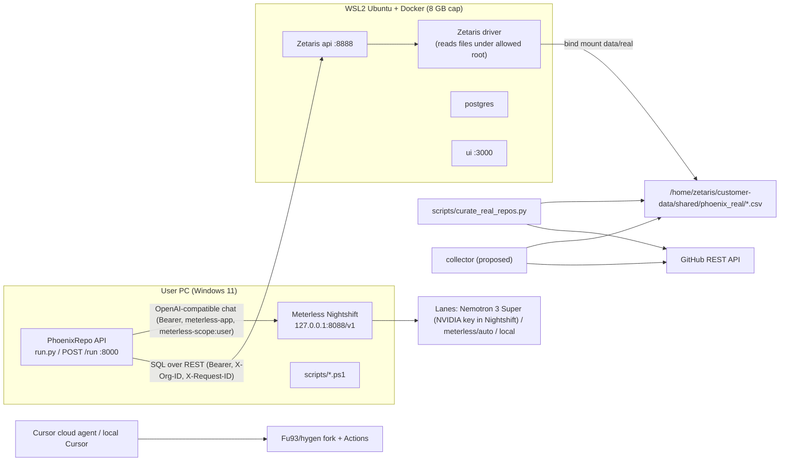

# PhoenixRepo — Technical Architecture

Status: written 22 Oct 2026 ~16:45 BST against `main` at `33b15f7`. "Current" means code on `main`. "Proposed" means not yet implemented; the implementing branch's tests win when it merges.

## 繁體中文摘要

- 資料唯一來源是 **Zetaris**（REST `POST /api/v1.0/sql-editor/sqls/run`）；agent 只能送白名單內的單句 SELECT（`app/sql_catalog.py`）。
- **今天 16:30 BST 在你電腦上驗證過**：driver 只允許 `ZETARIS_LOCAL_FILE_SYTEM_ROOT_PATH=/home/zetaris/customer-data/shared` 底下的檔案；把 `data/real` 掛到 driver 的 `/home/zetaris/customer-data/shared/phoenix_real` 後，`load_real.ps1 -ContainerPath ...` 成功，`phoenix.repo_evidence` 5 列、`phoenix.revival_signals` 19 列。已知 bug：重跑時 Zetaris 對「already exists」回 HTTP 400，腳本當成失敗（exit 1）；null 會以 JSON null 回來（policy 已能處理）。
- **模型一律經過 Nightshift**：lane 順序 `nvidia/nemotron-3-super-120b-a12b` → `meterless/auto` → Nightshift 提供的本機模型（Ollama 是否能經 Nightshift 提供、Groq 是否可路由：**未驗證**）。每次 run 有呼叫預算、prompt hash 快取、429/timeout 指數退避；judge 永遠只是建議，provider 失敗不能擋住 verdict；每次 fallback 都寫進 trace。
- **注意**：目前程式碼中，非 judge 的角色（archaeologist 等）呼叫 Nightshift 失敗會讓整個 run 回 502——這是要修的第一個可靠性缺口。
- 直接呼叫 NVIDIA 的 `LLM_PROVIDER=nvidia` 會繞過 Nightshift，demo 時禁止使用。

---

## 1. System context



The agents never call GitHub. Only the offline curation script and the proposed collector do, and they write CSVs that Zetaris serves.

## 2. Code map (current)

| Path | Responsibility |
| --- | --- |
| `api/run.py` | FastAPI: `GET /health`, `POST /run` (`schemas/input.py` `RunRequest{repository, mode: sample\|live, max_repair_iterations 0–10 default 2}`); `InvestigationError` → `{"error":{type,message}}` with status |
| `run.py`, `main.py` | uvicorn on `0.0.0.0:$PORT` (default 8000) |
| `app/investigation.py` | `InvestigationOrchestrator.run()`: collect → claims → H-MEM → judge → policy → states → architect/builder → diagnostician loop → verdict → evidence pack → response |
| `app/agents/policy.py` | deterministic verdict (`decide`, `normalize_profile`, `normalize_signal`, `ci_kind`, `alternatives_factor`, `explanation`) |
| `app/agents/validate.py` | `critique_archaeologist`, `critique_judge`, `critique_builder` |
| `app/agents/llm_judge.py` | advisory judge prompt, `combine()` (guard wins on missing evidence) |
| `app/sql_catalog.py` | allowed SQL, columns, licence set, thresholds |
| `app/adapters/zetaris.py` | REST client, single-statement guard, header-insensitive row parsing |
| `app/adapters/sample_zetaris.py` | same SQL answered from `data/sample` and `data/real` |
| `app/adapters/meterless.py` | Nightshift client: discovery, auto-detect, chat, served-model capture |
| `app/adapters/nvidia.py` | direct NVIDIA client (bypasses Nightshift — dev only, see §8) |
| `app/llm/provider.py` | `build_llm`, `BoundLLM` (records `requested_model`, `served_model`) |
| `app/llm/parsing.py` | last-JSON-object extraction after reasoning prose / `<think>` |
| `app/llm/standin.py` | deterministic sample stand-in (deliberately wrong first attempts) |
| `app/engines/hmem/*` | H-MEM store, retrieval (hybrid score), trust ledger |
| `app/engines/markovian.py` | `ChunkManager` (max 8 chunks, 1200-char carryover, per-chunk timeout) |
| `app/trace_log.py` | `logs/trace-<run_id>.jsonl`, secret redaction |
| `scripts/render_trace.py` | trace → markdown/HTML (`--format md\|html --output`) |
| `scripts/demo_live.ps1`, `scripts/demo_summary.py` | live preflight + 3 runs → `logs/demo-live.md` |
| `scripts/zetaris/*.sql`, `load_real.ps1`, `phoenix-real-data.compose.yml` | semantic layer + real-data load |
| `scripts/curate_real_repos.py` | GitHub REST → `data/real/*` + `provenance.json` |
| `evidence/`, `state/`, `audit/`, `artifacts/`, `run/` | pre-existing 8 Oct infrastructure |

## 3. Zetaris integration

### 3.1 Contract (verified on the user's PC, 22 Oct 2026)

- `POST http://localhost:8888/api/v1.0/sql-editor/sqls/run`
- Headers: `Authorization: Bearer $ZETARIS_API_KEY`, `X-Org-ID: 1`, `X-Request-ID: <uuid>`
- Body: `{"queryId": "<uuid>", "sql": "<one statement>", "source": "SqlEditor", "limit": 100}`
- Response: `{"headers": [...], "data": [[...], ...]}`; cell values are strings **or JSON null** (null verified 22 Oct 16:30 BST). Column names lowercase; the adapter matches case-insensitively (`app/adapters/zetaris.py` `_header_names`).
- Errors: 401/403 → `ZetarisError` 401; any ≥400 → 502 with query id; timeout 30 s (`ZETARIS_TIMEOUT_SECONDS`).
- **DDL on an existing object returns HTTP 400 with an "already exists" message, not 200** (verified). The Zetaris troubleshooting guide says for "Object already exists": "Check its owner and definition. Reuse a match" (https://zetaris.github.io/getting-started/docs/guides/troubleshooting.html).

### 3.2 File access (verified 22 Oct 16:30 BST)

- The driver refuses paths outside its allowed root: error text `Not allowed to access system file path` for `/opt/...` (the default `-ContainerPath /opt/phoenixrepo/data/real` in `load_real.ps1` and the committed compose file therefore **do not work**).
- Allowed root on this install: env `ZETARIS_LOCAL_FILE_SYTEM_ROOT_PATH=/home/zetaris/customer-data/shared` (spelling `SYTEM` is Zetaris's). A public DeepWiki page for another Zetaris distribution shows `/home/zetaris/data/shared`; trust `docker compose exec driver env` on your install, not docs.
- Working setup: bind-mount `data/real` at `/home/zetaris/customer-data/shared/phoenix_real` on service **`driver`** via an opt-in compose file, then `load_real.ps1 -ContainerPath /home/zetaris/customer-data/shared/phoenix_real`. Result: `SELECT` from `phoenix.repo_evidence` returned the 5 real rows; `phoenix.revival_signals` 19 rows.
- Repo fix: PR #3 (in review) changes `scripts/zetaris/phoenix-real-data.compose.yml` to service `driver` mounting `${PHOENIX_REAL_DATA}` at `/home/zetaris/customer-data/shared/phoenix_real:ro` and edits `load_real.ps1`. On `main` it is still the placeholder. Still to check in PR #3 (ROADMAP T3): `scripts/zetaris/phoenix-real-data.compose.yml` uses service `driver` and target `/home/zetaris/customer-data/shared/phoenix_real`; `load_real.ps1` default `-ContainerPath` should match; README §"Real snapshot and local Zetaris" should drop the "not verified" wording for those steps.

### 3.3 Known bugs in `scripts/zetaris/load_real.ps1` (verified)

1. **400 "already exists" treated as failure → exit 1.** In `Invoke-ZetarisSql`, a 400 lands in `catch`, the body is read, but `Get-ZetarisErrorText` only reads a top-level `error` property. If the 400 body's message is elsewhere, `Test-AlreadyExists` sees empty text and the statement is counted as failed. Fix: treat `code -eq 400` plus "already exists" anywhere in the raw body as `exists`; keep "duplicate" excluded.
2. **Null cells**: the verify step casts `[string]$cells[$originIndex]`; a null `data_origin` would become `""` and fail correctly. Python side: `blank_text(None)` → `""`, `as_bool(None)` → false (`app/agents/policy.py`). But `days_since_push = null` raises `ZetarisSchemaError` 502 ("must be a number") — intended, keep it, add a test with JSON null cells in `tests/adapters/test_zetaris_contract.py`.

### 3.4 Semantic layer

Agent SQL (only these, from `app/sql_catalog.py`):
```sql
SELECT repo_id, full_name, description, licence_spdx, primary_language, stars, forks, archived, days_since_push, open_issues, has_readme, has_license_file, has_tests, has_ci, ci_status, similar_repo_count, unique_capability, successor_url, category, html_url, data_origin FROM phoenix.repo_evidence WHERE repo_id = '<owner/name>'
SELECT repo_id, signal, detail, supports_revival FROM phoenix.revival_signals WHERE repo_id = '<owner/name>'
```
`repo_id` must match `^[A-Za-z0-9_./:-]{1,200}$`; single quotes are doubled; `assert_single_statement` rejects `;`-chained SQL.

Two ways the views get built:
- Real-data path (used for the demo): `load_real.ps1` → `PHOENIX_REAL` Lightning DB, FILESTORE tables `repo_evidence_file`, `revival_signals_file` → SchemaStore container `phoenix` → views `phoenix.repo_evidence`, `phoenix.revival_signals` (straight projections).
- Live-GitHub path (`scripts/zetaris/01–04*.sql`): `GITHUB_REST.repo_facts` REST table joined to curated CSV `phoenix_files.curated_signals`. Not used in the demo; one repo per REST table. If both were run, the first-created `phoenix.repo_evidence` wins (no DROP is sent).

## 4. Meterless Engine (H-MEM + Markovian), self-implemented

- **H-MEM** (`app/engines/hmem/`): `MemoryStoreService` (working tier → verdict promoted to long-term; JSON store `data/hmem/runtime-store.json`, gitignored; ledger `*.ledger.jsonl` append-only), `MemoryRetrievalService` (hybrid score `0.35 semantic + 0.20 keyword + 0.10 tag + 0.10 domain + 0.15 entity + 0.05 layer + 0.05 recency − 0.20 superseded`, `retrieval.py` `blend_score`), `TrustLedgerService`. Hash embedder (not neural). Prior verdict for the same `repo_id` is selected by `kind=verdict` before top-k and cited as `CLM-PRIOR-*` with source `hmem`. Conformance: project tests in `tests/engines/test_hmem_conformance.py`; the official TS runner (`HMEM_IMPL=... npx tsx conformance/runner.ts`, Meterless repo) has **not** been run.
- **Markovian** (`app/engines/markovian.py`): one `ChunkManager` per run (`app/investigation.py` `__init__`, `max_chunks=8`, `max_carryover_chars=1200`, `chunk_timeout_seconds=AGENT_STEP_TIMEOUT_SECONDS`=120). Each role attempt is one chunk; the carryover is a short JSON (role, attempt, parsed keys), not the transcript. The LLM judge call runs outside the chunk. Run budget `RUN_TIMEOUT_SECONDS` (600) is checked before every query and role call (`_check_run_budget`).
- **Two limits that bite in live mode (from reading the code, not yet observed):**
  1. Chunk count: worst case today is archaeologist 2 + market judge 2 + architect 1 + builder 2 + diagnostician `max_repair_iterations` (API default 2) = **9 > 8 → `IterationLimit` HTTP 500**. `demo_live.ps1` sends `max_repair_iterations: 0` (max 7). Adding the planner (1–2 chunks) can push a normal run over 8. Fix with the planner work: raise `max_chunks` (e.g. 12) or give the planner its own manager, and add a test.
  2. The chunk timeout is checked after the call returns: a role call that takes longer than 120 s (Nightshift's chat timeout is 180 s, model loads can be slow) completes and *then* raises `StepTimeout` HTTP 504. Fix: align `AGENT_STEP_TIMEOUT_SECONDS` ≥ the chat timeout, or make §8's retry timeout shorter than the chunk timeout.

## 5. Data model

### 5.1 `phoenix.repo_evidence` (CSV `data/real/repo_evidence.csv`, `data/sample/repo_evidence.csv`)

| Column | Type in CSV | Origin (real) | Used by |
| --- | --- | --- | --- |
| repo_id | text `owner/name` | `full_name` | key |
| full_name | text | API | trace |
| description | text | API | trace |
| licence_spdx | text, may be empty | API `license.spdx_id` | value gate |
| primary_language | text | API | similar query |
| stars, forks | int | API | context only |
| archived | bool text | API | recorded, never decisive |
| days_since_push | int | curated (UTC days `pushed_at`→`collected_at`) | value gate (≥180) |
| open_issues | int | API | context |
| has_readme | bool | curated (tree) | context |
| has_license_file | bool | curated | validation gate |
| has_tests | bool | curated (tree path rules) | validation gate |
| has_ci | bool | curated (workflow files or runs) | context |
| ci_status | text: success/failure/…/empty | curated (latest eligible build/test run) | validation gate |
| similar_repo_count | int or empty | curated (search total) | alternatives_factor only |
| unique_capability | text | description verbatim | value gate (non-empty) |
| successor_url | url or empty | curated (README phrase rule) | value gate |
| category | text | first topic / language | context |
| html_url | url | API | trace |
| data_origin | `github_rest_api:<date>` or `synthetic_labelled` | — | provenance |

Exact rules: `data/real/provenance.json` `column_rules`.

### 5.2 `phoenix.revival_signals` (CSV `revival_signals.csv`)

`repo_id, signal, detail, supports_revival`. Signals used today: `tests_present`, `tests_absent`, `ci_success`, `ci_failure` (detail names the failed step and run URL), `ci_unknown`, `archived`, `successor_recorded`, `licence_missing`, `alternatives_factor`. Real snapshot: 19 rows.

### 5.3 Revival tables — as implemented in PR #3 (in review, not on `main`)

`phoenix.revival_attempts` ← `data/real/revival_attempts.csv` (one row per stage; written by `scripts/collect_revival_attempt.py`; provenance in `data/real/revival_attempts_provenance.json`):

`repo_id, fork_full_name, upstream_full_name, stage (revive|refactor|upgrade), status (not_attempted|success|failure|…), ci_status, ci_run_url, ci_run_name, ci_run_event, commit_sha, compare_url, default_branch, head_sha, data_origin`

On the branch today all three hygen rows are `not_attempted`, `head_sha 26f76d8…`, `data_origin github_rest_api:2026-10-22`.

`phoenix.revival_sources` ← `data/real/revival_sources.csv` (documents the planner may quote): `repo_id, source_id, kind (workflow|package|issue|issue_list|compare|actions), title, url, excerpt, data_origin`. hygen has 6 rows (workflow-ci, package-json, issue-450, issue-list, compare-fork, fork-actions).

Views are added to `scripts/zetaris/04_phoenix_views.sql` (over `phoenix_files.*_file`) and to `load_real.ps1`; agent SQL to `app/sql_catalog.py`. An empty result means "not yet attempted / no cited source", not a missing view.

Suggested additions (not in PR #3): `failed_step` (jobs API) and `collected_at` columns on attempts; a `ci_log` source kind carrying the decisive log line (for hygen: `Cache service responded with 400`), so the planner can cite why Stage 1 must bump `setup-node`.

### 5.4 Run outputs

- Response (`schemas/output.py` `RunResponse`): `run_id, run_fingerprint, mode, foundation_only, status, state, evidence_count, claims_count, audit_events, decision, claim_verification, evidence_pack{path, context_path, integrity_hash}, log_file, metadata{investigation_version, reason, verdict_text, claims[{claim_id, statement, evidence[{evidence_id, query_id, sql, source, zetaris_mode}]}], zetaris{mode, queries, load_bearing}, llm{provider, model, requested_model, served_model, sample_standin, label, explanation_accepted, primary_provider, judge{advisory, exhausted, failure,…}}, hmem{recalled, prior_verdicts}, scope…}`. Proposed: `metadata.revival{status, prd, attempts[]}` and `metadata.llm.lanes[]`.
- Trace line (`app/trace_log.py`): `timestamp, run_id, agent_name, action, input_summary, output_summary, target_agent, confidence, retry_count, status, event`; summaries are redacted against `settings.secret_values()` and truncated (500 chars). Actions include `RUN_STARTED, EVIDENCE_COLLECTION_STARTED/COMPLETED, ZETARIS_QUERY, MODEL_OUTPUT, LLM_JUDGE, MODEL_EXPLANATION_REJECTED, CLAIM_VERIFIED, VERDICT` and audit `STATE_TRANSITION`s. Proposed: `LLM_CALL` and `LLM_FALLBACK` (§8).
- Evidence pack under `run_artifacts/` (gitignored), with integrity hash.

## 6. Sequence diagrams

### 6.1 Judge run (current code, live mode)

```mermaid
sequenceDiagram
  autonumber
  participant C as Client (demo_live.ps1 / curl)
  participant O as Orchestrator
  participant Z as Zetaris REST
  participant M as H-MEM
  participant L as Nightshift (BoundLLM)
  participant V as Validator (guard + LLM judge)
  participant P as Policy
  C->>O: POST /run {repository, mode:"live"}
  O->>Z: SELECT ... FROM phoenix.repo_evidence WHERE repo_id=...
  O->>Z: SELECT ... FROM phoenix.revival_signals WHERE repo_id=...
  Z-->>O: {headers, data} (404 RepositoryNotInZetaris if no row)
  O->>M: hydrate; prior verdicts (kind=verdict) -> CLM-PRIOR-*
  loop attempt 1..2
    O->>L: archaeologist chunk
    L-->>O: reasoning + JSON {claims}
    O->>V: critique_archaeologist (ids known? row values quoted?)
    V->>L: advisory judge {decision accept|reject}
    Note over V: guard reject wins; judge reject forces retry; judge error -> logged, ignored
  end
  O->>M: store claims; recall evidence (hybrid score)
  loop attempt 1..2
    O->>L: market_judge chunk (row, signals, memories)
    O->>V: critique_judge (decision == decide()? quotes?) + advisory judge
  end
  O->>P: decide(row, signals)
  alt NO_GO
    P-->>O: NO_GO (architect/builder/diagnostician skipped)
  else candidate
    O->>L: architect chunk; builder chunk (PASS forbidden)
    opt RESURRECTION_FAILED and repairs left
      O->>L: diagnostician chunk
      O->>Z: re-query revival_signals
      O->>P: decide again
    end
  end
  O->>M: promote verdict to long-term
  O-->>C: RunResponse + logs/trace-<run_id>.jsonl
```

### 6.2 Plan → act → verify (proposed)

```mermaid
sequenceDiagram
  autonumber
  participant U as User
  participant O as Orchestrator
  participant Z as Zetaris
  participant PL as Planner (Nightshift)
  participant V as Validator
  participant CA as Coding agent (Cursor)
  participant F as Fu93/hygen + Actions
  participant CO as Collector
  U->>O: POST /run jondot/hygen
  O->>Z: repo_evidence, revival_signals, revival_sources, revival_attempts
  O->>O: value gate passes; no proven attempt -> RESURRECTION_FAILED (candidate)
  O->>PL: plan(row, signals, issues, prior attempts)
  PL-->>O: stages REVIVE/REFACTOR/UPGRADE with evidence ids + issue URLs
  O->>V: every item cites known ids/URLs? REVIVE acceptance = CI green on master?
  V-->>O: accept or one retry
  O-->>U: verdict + revival PRD (metadata.revival.prd)
  U->>CA: execute Stage 1 on fork (prompt in ROADMAP)
  CA->>F: PR -> merge to master
  F->>F: workflow CI runs (ubuntu+windows matrix)
  U->>CO: python scripts/collect_revival_attempt.py (PR #3; see its --help)
  CO->>F: GET actions/runs?branch=master, runs/{id}/jobs, branches/master
  CO->>Z: (via CSV + load_real.ps1) phoenix.revival_attempts
  U->>O: POST /run jondot/hygen again
  O->>Z: revival_attempts row: stage revive, status success, ci_status success, run URL + commit
  O->>O: gate holds -> RESURRECTED; H-MEM cites prior RESURRECTION_FAILED
  O-->>U: RESURRECTED with run_url evidence
```

## 7. Failure handling

| Failure | Current behaviour | Proposed change |
| --- | --- | --- |
| Zetaris unreachable / 5xx / timeout | `ZetarisError` → HTTP 502, run stops (no fallback, by design) | Keep. Zetaris is load-bearing. |
| Zetaris 401/403 | 401 | Keep. |
| No row for repo | 404 `RepositoryNotInZetaris` | Keep. |
| Schema drift (missing column, non-numeric `days_since_push`) | 502 `ZetarisSchemaError` | Keep; add JSON-null test. |
| LLM judge timeout/401/error | logged `LLM_JUDGE` status timeout/unauthorized/error, `raw_decision=unavailable`, verdict still produced, noted in text | Keep; add lane fallback before giving up (§8). |
| **Role call (archaeologist/market judge/architect/builder/diagnostician) provider error** | `MeterlessError` is an `InvestigationError` → propagates out of `_role_chunk` → **HTTP 502, no verdict** | §8: lane fallback + backoff; if all lanes fail, degrade: market judge → policy `explanation()`; archaeologist → deterministic row-quoting claims labelled `degraded`; architect/builder/planner → skipped with `degraded: provider_unavailable`. Verdict always produced. |
| Role reply not parseable JSON | `InvestigationError` → error status | Count as a failed attempt; retry once on next lane; then degrade as above. |
| Builder rejected twice | 422 `ValidatorBlocked` | Keep for sample; in live, degrade to "builder skipped" so a model quirk does not hide the verdict (decision for user). |
| Run budget exceeded | `_check_run_budget` raises | Keep; budget 600 s. |
| `mode:"live"` while `SAMPLE_MODE=true` | 400 `SampleMode` | Keep (no silent fallback). |
| Collector: GitHub 403 rate limit | n/a | Write no row, exit non-zero, print reset time; never write `success` without a run. |

## 8. Model provider and fallback strategy — Nightshift only

### 8.1 Rules

1. **Nightshift is the only live model route.** Every live call goes to `METERLESS_BASE_URL` (`http://127.0.0.1:8088/v1`) with `Authorization: Bearer <runtime token>`, `meterless-app: phoenixrepo`, and `meterless-scope: user` on chat (`app/adapters/meterless.py` `_headers`). Provider keys (NVIDIA free API, possibly Groq) live **only in Nightshift's Providers tab**, never in `.env`.
2. **No bypass.** `LLM_PROVIDER=nvidia` (`app/adapters/nvidia.py`, `https://integrate.api.nvidia.com/v1`) calls NVIDIA directly and bypasses Nightshift. It must not be used in a live demo run. Proposed: refuse `LLM_PROVIDER=nvidia` when `mode=live` unless `ALLOW_DIRECT_PROVIDER_DEV=true`, and label any such trace as non-compliant.
3. **Auto-detect hazard.** `AUTO_DETECT_PORTS = (8088, 8090, 8787, 11434)` in `app/adapters/meterless.py` follows the Meterless contract, but 11434 is Ollama's default port. If Nightshift is down and Ollama is up, `scripts/test_meterless_connection.py --auto-detect` could find Ollama directly. Do not copy an 11434 base URL into `.env`; local models must be reached *through* Nightshift.

### 8.2 Lane order (proposed `METERLESS_LANES`, comma-separated, first wins)

| Lane | Model id sent to Nightshift | Status |
| --- | --- | --- |
| L1 | `nvidia/nemotron-3-super-120b-a12b` | Listed by `/v1/models` and answered HTTP 200 on 22 Oct 15:00 BST, **served as `nvidia/nemotron-3-ultra-550b-a55b`** (Nightshift reroutes). Uses the NVIDIA free API key inside Nightshift; rate limits **unknown, not measured**. |
| L2 | `meterless/auto` | Answered HTTP 200 on 22 Oct, also served as `nvidia/nemotron-3-ultra-550b-a55b`. Nightshift's own routing; may hit the same upstream key → a 429 on L1 may repeat on L2. |
| L3 | a local model served by Nightshift, e.g. `meterless/local` (a documented Meterless disposition) or a `meterless/*`/local id that appears in your `/v1/models` | **UNVERIFIED** that Nightshift exposes the user's Ollama models. Verify on Day 1 by listing `/v1/models` with Ollama running. If it is not listed, L3 does not exist; do not call Ollama directly. |
| (Groq) | only if Nightshift lists a Groq-routed id | **UNVERIFIED** whether Nightshift can route Groq. Do not add until seen in `/v1/models` and one chat succeeds through Nightshift. |

`nemotron-3.5-super-vl-120b` was reported flaky — not a lane.

### 8.3 Call policy (proposed; implement in `app/llm/provider.py` around `BoundLLM.complete`)

- **Per-run call budget**: `METERLESS_MAX_CALLS_PER_RUN` (proposed default 24). Current max calls per live run from the code: archaeologist 2 role + 2 judge, market judge 2 + 2, architect 1, builder 2, diagnostician ≤ `max_repair_iterations` (demo uses 0) → **≤ 11 calls without planner/repairs**; planner adds ≤ 2 + 2 judge. At the observed 8–12 s per call that is roughly 1.5–3 minutes per repo before any retry (estimate from code, not a measurement). Budget exhausted → judge calls are skipped first (advisory), then role calls degrade (§7). Retries and fallbacks count against the budget.
- **Response cache**: key = `sha256(lane_model_id + canonical_json(messages) + max_tokens)`; stored under `logs/llm-cache/<hash>.json` (inside gitignored `logs/`? — note: `.gitignore` only ignores `logs/*.jsonl`, so add `logs/llm-cache/` to `.gitignore`). Only responses that parsed into the expected JSON are cached. A hit is logged `lane=cache` with the original `served_model`. Cache is **off by default for the judge and for demo recordings** unless the video says "cached" (honesty); `LLM_CACHE=off|read|readwrite`.
- **Backoff**: on HTTP 429, 5xx, timeout, or connection error: retry the same lane after 2 s, 4 s, 8 s (the Meterless provider contract's 429 schedule on meterless.ai/engines.html), honouring `Retry-After` if larger, capped by remaining run budget; then move to the next lane. **401/403 → no retry, no fallback** (token problem; `MeterlessUnauthorized`), judge logs `unauthorized`, roles degrade.
- **Timeouts**: keep 180 s per chat (`METERLESS_TIMEOUT_SECONDS`, contract's model-load budget) for L1's first call; proposed 60 s for retries so one slow lane does not eat the 600 s run budget.
- **Judge stays advisory**: any provider failure in the judge path leaves the deterministic guard result unchanged (`_apply_llm_judge` already does this). Provider failure never blocks a verdict once §7's degrade path exists.
- **Trace every call and fallback**: new trace action `LLM_CALL` per attempt with `{role, lane, lane_index, requested_model, served_model, http_status, latency_ms, attempt, cache_hit, budget_left}`; `LLM_FALLBACK` with `{from_lane, to_lane, reason: 429|timeout|5xx|parse_error|budget}`; `metadata.llm.lanes[]` summarises per lane counts. Never log the token (trace redaction already covers configured secrets).

### 8.4 Live measurement (ROADMAP T2)

Record in `logs/provider-measurements.md` (and summarise in README): per lane N=10 identical small chat calls + 3 full `POST /run`: p50/p90 latency, count of 429/5xx/timeouts, served_model distribution, time of day (BST/GMT). No number goes into the video or submission unless it came from this file.

## 9. Security and secrets

- Secrets: `ZETARIS_API_KEY`, `METERLESS_RUNTIME_TOKEN` (file `%LOCALAPPDATA%\ai.meterless.runtime\proxy-token`), NVIDIA/Groq keys (inside Nightshift only), `GITHUB_TOKEN` (optional for curation/collector). Never in git, docs, video, screenshots, or chat logs.
- `.env` is gitignored (`.gitignore`: `.env`, `.env.*`, `!.env.example`); placeholders are treated as unset (`config/settings.py`). Prefer process env vars set in the PowerShell session.
- Trace redaction: `HackathonTrace(..., settings.secret_values())` replaces secret values in summaries; `tests/security/test_secret_redaction.py`, `test_artifact_secret_scan.py`, `test_sample_network_boundary.py` (sample mode cannot touch network/secrets).
- Scripts print status codes, not bodies or keys (`load_real.ps1`, `demo_live.ps1`).
- SQL injection surface: only whitelisted SELECTs with a regex-checked, quote-escaped `repo_id`; single statement enforced.
- Prompt-injection surface: repo descriptions/issue titles enter prompts as data. The validator only accepts claims citing known ids and the policy decides the verdict, so injected text cannot change the verdict. Planner output is validated the same way.
- Before recording: hide the Nightshift console token, the Zetaris UI API-key page, and any terminal history showing env assignments. Before pushing: `git grep -n -I -E "(nvapi-|gsk_|ghp_|gho_|github_pat_)"` should return nothing.

## 10. Testing strategy

- Offline suite: `py -3 -m pytest -q` (138 passed on the box, 22 Oct 2026, Python 3.13; CI uses 3.12) + `py -3 scripts/compliance_check.py` (`.github/workflows/ci.yml`). Never calls live Zetaris/Nightshift (mock HTTP + sample mode).
- Areas: adapters contract (`tests/adapters/`), policy blanks and curation (`tests/agents/test_policy_blanks.py`, `tests/data/test_curation.py`), LLM judge combine/failure (`tests/agents/test_llm_judge.py`), H-MEM/Markovian (`tests/engines/`), parsing (`tests/llm/test_parsing.py`), security, schema, replay, evaluator smoke, demo summary.
- To add (with the features): JSON-null cells; 400-already-exists in a PowerShell-free unit (port the decision logic to Python or test via a fake server); lane fallback order/backoff/budget/cache with a fake Nightshift returning 429/timeout/200; degrade path (all lanes down → verdict still produced, `metadata.llm.degraded`); planner validator (unknown issue URL rejected); collector eligibility (CodeQL success ≠ success; `action_required` ≠ success; branch ≠ default ≠ proof; head mismatch ≠ proof); policy gate table for RESURRECTED with attempts; update `tests/data/test_curation.py` expectations for matterbridge under §5.2 of the PRD.
- Live checks (manual, Windows): `py -3 smoke_test.py`, `py -3 scripts/test_meterless_connection.py`, `scripts/demo_live.ps1`, provider measurement (§8.4).

## 11. Verified vs not verified (as of 22 Oct 2026 16:45 BST)

| Item | Status |
| --- | --- |
| Nightshift `/v1/models` 200; chat on `meterless/auto` and `nvidia/nemotron-3-super-120b-a12b` 200 in 8–12 s, served `nvidia/nemotron-3-ultra-550b-a55b`, replies start with reasoning prose / `<think>` | Verified on user PC 15:00 BST |
| Zetaris REST shape, string-or-null cells, 400 on already-exists | Verified 16:30 BST |
| Driver path allow-list; mount on `driver` at `/home/zetaris/customer-data/shared/phoenix_real`; load_real with `-ContainerPath`; 5 + 19 rows | Verified 16:30 BST |
| Nightshift LLM judge inside `POST /run`; `demo_live.ps1` end to end | **Not run** |
| Ollama via Nightshift (L3); Groq via Nightshift | **Unverified** |
| NVIDIA free API rate limits | **Not measured** |
| hygen build/tests on Node 20 Linux | Verified on box (not on Windows, not on Node 22) |
| hygen fork CI | **Not run yet** (0 runs) |
| Official H-MEM/Markovian TS conformance runners | **Not run** |

## 12. Risk register

Likelihood/Impact: H/M/L. Owner: **U** = 弘軒 on Windows, **CA** = Cursor cloud agent, **LC** = local Cursor.

| # | Risk | L | I | Mitigation | Owner |
| --- | --- | --- | --- | --- | --- |
| R1 | Live `POST /run` with Nightshift judge never run; unknown failure modes | H | H | Run `demo_live.ps1` on Day 1 evening; fix before any feature work | U |
| R2 | A role-call provider error returns HTTP 502 with no verdict (§7) | M | H | Lane fallback + degrade path (§8) | CA |
| R3 | NVIDIA free API 429s (limits unknown); L2 shares the same upstream | M | H | Backoff 2/4/8 s, call budget, cache, L3 local lane; measure on Day 1 (§8.4); record the video when the measurement shows headroom | U/CA |
| R4 | Nightshift reroutes to `nemotron-3-ultra-550b-a55b`; Nemotron-prize claims must say "requested Super, served Ultra" | H | L | Trace both ids; word submission accordingly | U |
| R5 | L3 local model via Nightshift unavailable (Ollama not exposed) | M | M | Verify `/v1/models`; if absent, drop L3 and rely on degrade path; never call Ollama directly | U |
| R6 | Groq routing through Nightshift unverified | M | L | Only add after seen in `/v1/models` + one 200 chat | U |
| R7 | `load_real.ps1` exits 1 on re-run (400 already exists) | H (verified) | M | Check PR #3's `load_real.ps1` change covers HTTP 400 + "already exists"; else fix T3; until then check rows by `SELECT` in the UI | CA |
| R8 | Compose file on `main` targets placeholder service and `/opt/...` (refused by driver) | H (verified) | M | Fixed in PR #3 (in review); `driver` + `/home/zetaris/customer-data/shared/phoenix_real` | CA |
| R9 | Markovian `max_chunks=8` exceeded once planner/repairs added (`IterationLimit` 500); 120 s chunk timeout vs 180 s chat timeout | M | H | Raise/separate limits with planner PR; test | CA |
| R10 | hygen fork CI: Windows job or Node 22 fails; fork Actions need a one-time enable | M | H | Matrix fallback `[18.x, 20.x]`; check the Actions tab; if Windows fails for an environmental reason, document and keep Windows in the matrix only if green (do not silently drop it — say so in the PR and video) | CA/U |
| R11 | Stage 1 looks "too easy" to judges | M | M | Show the diagnosis (cache 400 vs test failure) as the agent's insight; Stage 2/3 show real code change with issue URLs | U |
| R21 | PR #3 Stage 1 keeps `setup-node@v2` (only drops Node 14/17) → likely the same `Cache service responded with 400` → Stage 1 stays red | H | H | Move action bumps into Stage 1 (PRD §8.0) | CA |
| R12 | Changing RESURRECTED semantics breaks `tests/data/test_curation.py` and README claims | H | M | Update tests/README in the same PR; matterbridge becomes "candidate" | CA |
| R13 | WSL 8 GB cap: Zetaris + Docker build of PhoenixRepo at the same time is slow | M | M | Run PhoenixRepo natively in the Windows venv, not in Docker, during the demo | U |
| R14 | Clock change 25 Oct (BST→GMT) causes deadline confusion | L | H | All deadlines in UTC: 27 Oct 23:45 UTC = 23:45 UK; target submit by 27 Oct 17:45 | U |
| R15 | Secrets leak in video/screenshots/trace | L | H | §9 checklist; trace redaction; record with env set in a hidden window | U |
| R16 | Assistant credits run out mid-build | M | H | ROADMAP "continuing alone" prompts; small PRs; everything Windows-only is already owned by U | U/LC |
| R17 | Rules text says "must use Cursor" while organiser update said optional | L | M | We used Cursor; declare cloud + local usage | U |
| R18 | PowerShell `Invoke-WebRequest` default timeout may cut a long `POST /run` (not verified) | M | M | If `demo_live.ps1` reports a timeout, add `-TimeoutSec 900` to its `/run` call (T4) | CA/LC |
| R19 | GitHub API rate limit (60/h unauthenticated) during curation/collector | M | M | Use `GITHUB_TOKEN` from env (never written); collector makes ≤5 calls | U |
| R20 | Submission form fields unknown (behind login) | M | M | Open the form Day 2, paste outline from PRD Appendix B, save draft | U |

## 13. Sponsor depth — what is real, what is a spike

Each item is marked **VERIFIED** (seen working on the user's install or in code), **DOCUMENTED** (in a public Zetaris/Meterless page, not tried here), or **UNVERIFIED** (idea; needs a spike before it goes in the video). Only VERIFIED items may be claimed in the submission as working.

### 13.1 Zetaris

| # | Feature | Status | Design |
| --- | --- | --- | --- |
| Z1 | SQL over REST as the agents' only evidence path | VERIFIED (user PC, 22 Oct) | current code (§3) |
| Z2 | FILESTORE CSV tables under the allowed root + SchemaStore views | VERIFIED (5 + 19 rows) | current `load_real.ps1` with `-ContainerPath` |
| Z3 | Zetaris pulling GitHub REST directly: `CREATE LIGHTNING DATABASE GITHUB_REST …` + `CREATE LIGHTNING REST TABLE repo_facts FROM GITHUB_REST REQUEST(endpoint "https://api.github.com/repos/OWNER/REPO", method "get", response_type "json", …)` | In repo (`scripts/zetaris/01_github_rest_repo.sql`, `02_github_repo_table.sql`, `04_phoenix_views.sql`), **UNVERIFIED on the user's install** (README says DDL "not verified against a live instance") | Spike S1 (ROADMAP T9): run 01/02 for `jondot/hygen` in the SQL Editor; `SELECT full_name, license.spdx_id, pushed_at FROM github_rest.repo_facts`. If it works, the profile's API columns come *live through Zetaris* and only curated columns stay in CSV — strong Zetaris story ("federates a live API with curated files"). |
| Z4 | Fork CI read by Zetaris itself: REST table on `https://api.github.com/repos/Fu93/hygen/actions/runs?branch=master&per_page=5` | **UNVERIFIED** (unknown whether the REST table flattens the nested `workflow_runs` array; unauthenticated limit 60 req/h; a token in DDL would be stored in Zetaris metadata — do not put one there) | Spike S2 after S1. If arrays flatten, `phoenix.revival_attempts` can be a view over the REST table and the Python collector shrinks to eligibility rules. If not, keep the collector → CSV (default plan). |
| Z5 | Layered views raw → signals → verdict evidence | Design; containers/views VERIFIED as a mechanism (Z2) | `raw` layer: `phoenix_real.*_file` FILESTORE tables and (if S1) `github_rest.repo_facts`; `signals` layer: `phoenix.revival_signals`, `phoenix.revival_attempts`, `phoenix.revival_sources`; `evidence` layer: `phoenix.repo_evidence` (one row per repo, what the policy reads). Agents may only query the evidence and signals layers (`app/sql_catalog.py`). Show the three layers in the Zetaris UI schema browser in the video. |
| Z6 | Query audit trail to trace each claim to source | DOCUMENTED for Zetaris Enterprise: "The metadata repository … also logs a complete auditing trail of queries", registered with `CREATE DATASOURCE … jdbcurl ".../auditLog"` then `REGISTER DATASOURCE TABLES` (https://kbase.zetaris.com/knowledge/meta). A public DeepWiki page for another Zetaris distribution shows `AUDIT_LOG_DATABASE_URL=jdbc:postgresql://zetaris-db:5432/audit`. The user's install has an `audit` DB in its postgres (user report). **UNVERIFIED** that it records our `queryId`/`X-Request-ID` or that it can be registered via SQL on this install. | Spike S3: in WSL `docker compose exec postgres psql -U <user> -l` and `\dt` in `audit` (read-only; credentials from the platform `.env`, never copied into the repo). If a table holds query text + our `queryId`, register it as a JDBC datasource and add `phoenix.query_audit`; then each `metadata.claims[].evidence[].query_id` resolves to a Zetaris audit row → "every claim traces to a Zetaris-logged query". If not, the claim-to-query link stays in our trace (already true today). |
| Z7 | Data Lineage view / SQL Editor History tab | DOCUMENTED (https://kbase.zetaris.com/knowledge/data-lineage-overview; SQL Editor "History tab", https://kbase.zetaris.com/knowledge/sql-editor-overview); **UNVERIFIED** on this install | If the UI shows lineage from `phoenix.repo_evidence` back to the FILESTORE/REST tables, take one screenshot for the deck. Zero code. |

### 13.2 Meterless Nightshift

| # | Feature | Status | Design |
| --- | --- | --- | --- |
| N1 | Primary OpenAI-compatible provider, bearer token, `meterless-app`, `meterless-scope: user` | VERIFIED (user PC 22 Oct; code) | current |
| N2 | Requested vs served model in trace | VERIFIED (code + 22 Oct observation) | current |
| N3 | Routing ids listed by `/v1/models`: `meterless/auto`, `meterless/fast`, `meterless/deep`, `meterless/judge`, Nemotron ids | VERIFIED as *listed* (22 Oct); behaviour of `fast`/`deep`/`judge` not observed | Per-role routing (proposed `METERLESS_ROLE_MODELS`): archaeologist/market_judge/architect/builder/diagnostician/planner → L1 lane order (§8.2); LLM judge → `meterless/judge` first, then the §8.2 lanes. The published contract says model ids are routing modes `meterless/<class>.<disposition>` with classes incl. `text`, `code`, `judge` and dispositions `auto, fast, deep, cheap, local, fusion` (meterless.ai/engines.html, "Add Meterless as a provider" and "Route each task to the right mode"). Each `LLM_CALL` trace line records role → requested id → served id. |
| N4 | Live class state `GET /v1/meterless/classes`, recipes `GET /v1/meterless/modes` | DOCUMENTED (same page); **UNVERIFIED** on the user's runtime | Spike: `curl` both with the token; if they answer, `demo_live.ps1` preflight prints class states and the routing table is built from them instead of constants. |
| N5 | Usage / cost statistics | **UNVERIFIED** — no usage or cost endpoint found in the published contract read on 22 Oct; whether chat responses carry an OpenAI-style `usage` object is not observed | Our own stats from the trace: calls per lane, latency p50/p90, 429 count, fallbacks, cache hits; tokens only if `usage` is present in responses. Render in `logs/provider-measurements.md` and the trace HTML. Never present an estimated cost as measured. |
| N6 | Meterless Engine H-MEM + Markovian | VERIFIED in code/tests (self-implemented in Python); the official TypeScript conformance runners were not run (they load a TS implementation) | Keep the honest "modelled on the published spec" wording. |

## 14. Ports and adapters (justified on its own merits)

Why: the two things most likely to change during the build are the model lane and how evidence reaches Zetaris; and the repair loop (plan → act → verify) should not depend on which forge or coding agent ran it. The code already half-has this: `adapters/contracts.py` (`AdapterStatus` protocol, pre-existing), `ZetarisClient` and `SampleZetaris` share `run_sql()`, `BoundLLM` wraps any client with `complete()`.

| Port | Current adapters | Rule |
| --- | --- | --- |
| `EvidencePort.run_sql(sql) -> ZetarisResult` | `ZetarisClient` (live), `SampleZetaris` (offline cache of the same SQL) | Every evidence source is reached **through Zetaris** (FILESTORE, REST table, JDBC). A new source means a new Zetaris table/view, not a new Python client. |
| `LLMPort.complete(messages, role) -> Reply{text, requested_model, served_model, lane, latency_ms, usage?}` | `MeterlessRuntime` (live), `SampleStandIn` (offline) | Lanes are Nightshift model ids (§8.2). `NvidiaDirect` is dev-only and refused in live mode. The lane/fallback/budget/cache logic sits in one wrapper around the port, so roles never know which lane answered. |
| `ForgePort` (proposed): `default_branch(repo)`, `runs(repo, branch)`, `jobs(run_id)` | GitHub REST in the collector (and `scripts/curate_real_repos.py` today) | Output is CSV rows loaded into Zetaris; the policy only sees Zetaris views. |
| `RepairExecutor` (proposed, out-of-run) | Cursor cloud agent, local Cursor (human-driven) | Input: planner PRD JSON; output: commits on the fork. Verification never trusts the executor's own claim — only the collector's CI rows. |

Do not refactor existing code into these ports during the hackathon unless a task already touches that file; the ports are the target shape for new code (fallback wrapper, collector).

## 15. Bonus (non-sponsor): weekly monitoring with n8n

Status: **UNCONFIRMED** — the user may have n8n on the PC (ports 5678/5679 reported, not checked). Bonus only; never on the critical path; not a sponsor technology.

Design: n8n Schedule Trigger (weekly) → for each dependency in a list → HTTP Request `POST http://127.0.0.1:8000/run` `{repository, mode:"live", max_repair_iterations:0}` (if n8n runs in Docker, use `host.docker.internal:8000`) → compare `decision` with `metadata.hmem.prior_verdicts[0]` (H-MEM already returns the previous verdict for the same `repo_id`) → if changed, notify (email/Discord) with `metadata.verdict_text` and the trace path. Requires the API, Zetaris and Nightshift running; with Nightshift asleep the run degrades (§7) and the notification must say so. Export the workflow JSON to `scripts/n8n/weekly-monitor.json` only if built and tested.
